# Hangar

Ready-to-fly missions. Download a `.miz`, drop it in `Saved Games/DCS/Missions/`, and open it in DCS.
To read a briefing or present the slide deck, download `briefing.html` or `slides.html` and open it in a browser (GitHub shows HTML as source code).
`index.html` in this folder lists every mission the same way.

Pilots: the briefing, slides and kneeboard only contain what your squadron knows at brief time. Don't open `director.html` before you fly.

These files are generated from `missions/<id>/mission.yaml`. Don't edit them by hand; see the main README to change a mission.

# Campaigns

Story arcs flown in order. Each campaign folder under `campaigns/` installs into DCS as a campaign (see its README).

| Campaign | Chapters | Dates | Premise |
| --- | --- | --- | --- |
| [HIGH TIDE](campaigns/high_tide/README.md): Ten days off the Abkhaz coast, May 2038 | 5 | 2038-05-11 → 2038-05-20 | Landing ships are gathering at Ochamchire, forty minutes from the flat Georgian beaches between Anaklia and Poti. From the Stennis, Springfield flight counts them, clears the approaches, blinds the battery that guards them, hits them alongside the quay, and stops what sails. |
| [IRON GATE](campaigns/iron_gate/README.md): Ten days in the Liakhvi valley, April 2038 | 5 | 2038-04-06 → 2038-04-16 | An armoured brigade comes south through the Roki tunnel toward Gori. The Hornet detachment at Vaziani was two weeks from going home. Find the column, slow it, clear the sky above it, hold the town, and close the tunnel behind it. |
| [WORK-UPS](campaigns/workups/README.md): Hornet detachment syllabus, January 2038 | 5 | 2038-01-15 → 2038-01-30 | Ten Hornets, three weeks and one instructor. Before the February partner exercise, every pilot in the detachment flies the same five events: day and night carrier quals, SEAD, CAS with a JTAC, and a graduation checkride. |

# HIGH TIDE campaign

Ten days off the Abkhaz coast, May 2038 5 chapters, 2038-05-11 to 2038-05-20. [Campaign page](campaigns/high_tide/README.md)

## HIGH TIDE · 1/5 · Operation HIGH TIDE: Eyes on Ochamchire

**Caucasus** · **2× F/A-18C Hornet** · **Reconnaissance** · 2038-05-11, step 05:20L · Carrier, Air refuelling

> "I don't need you to sink anything. I need you to count. And then I need you to come back so I can see what you counted." PRISM, 0430 brief

A month after the Roki tunnel, the war moved to the coast. Fishing boats out of Anaklia have been reporting grey ships at Ochamchire all week: big ones, with bow doors. Ochamchire's harbour is too small for a navy, but it isn't too small for landing ships, and the Georgian coast from Anaklia to Poti is flat, sandy and forty minutes away.

**Primary objective:** Fly the photo pass over Ochamchire harbour below 5,000 ft and bring the tape home.

| Download | |
| --- | --- |
| Mission | [01_ht_1_harbour.miz](campaigns/high_tide/01_ht_1_harbour.miz) |
| Briefing | [briefing.html](ht_1_harbour/briefing.html) |
| Slide deck | [slides.html](ht_1_harbour/slides.html) |
| Director's cut | [director.html](ht_1_harbour/director.html): **spoilers**, for whoever runs or debriefs the mission |

| Kneeboard | [01_mission.png](ht_1_harbour/kneeboard/01_mission.png) · [02_nav.png](ht_1_harbour/kneeboard/02_nav.png) · [03_threats.png](ht_1_harbour/kneeboard/03_threats.png) |

<a href="ht_1_harbour/kneeboard/01_mission.png">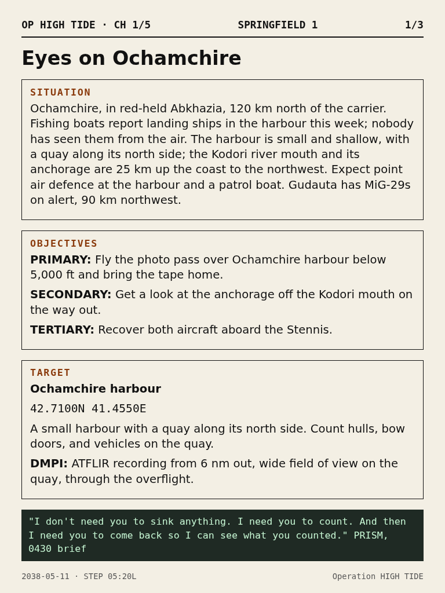</a> <a href="ht_1_harbour/kneeboard/02_nav.png">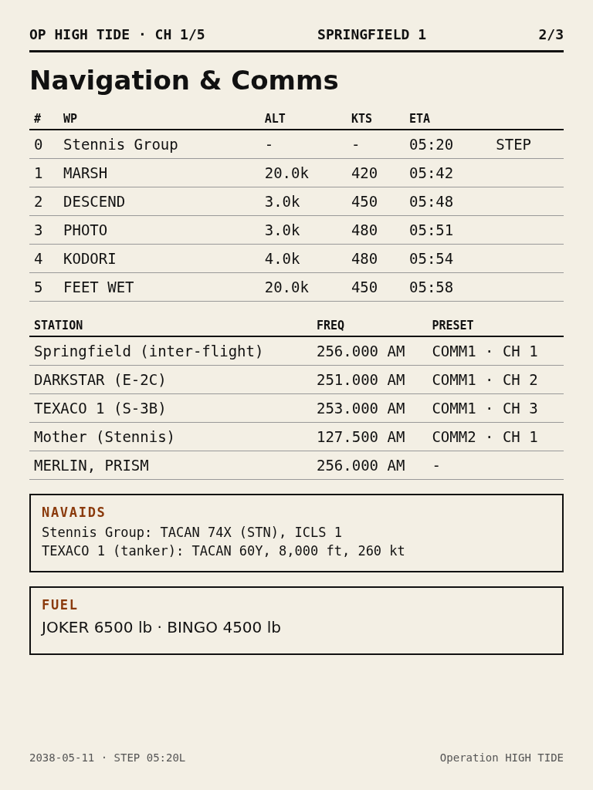</a> <a href="ht_1_harbour/kneeboard/03_threats.png">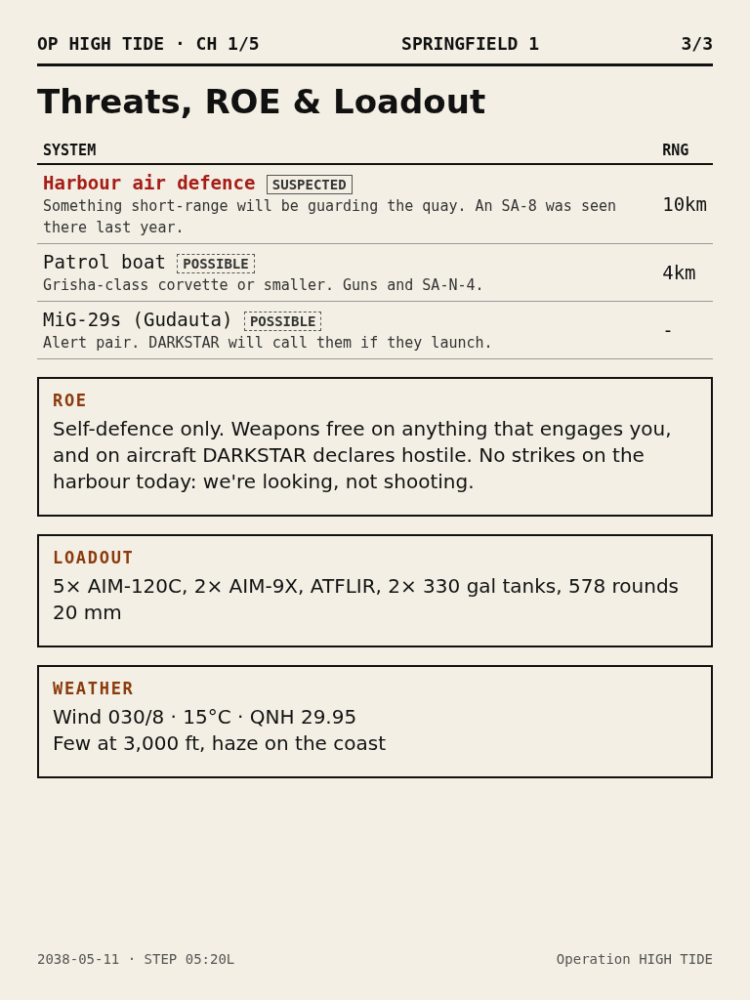</a> 

## HIGH TIDE · 2/5 · Operation HIGH TIDE: Minelayers in the Dark

**Caucasus** · **2× F/A-18C Hornet** · **Anti-ship** · 2038-05-13, step 22:10L · Carrier, Air refuelling

> "Every mine they put in the water tonight is a week of minesweeping we don't have. Get there while they're still laying." MERLIN, launch brief

Springfield's tape showed landing ships at Ochamchire. Two nights later, Georgian fishermen coming home to Poti saw something worse: fast boats with no lights, running slowly in lines across the harbour approaches and dropping things off their sterns.

**Primary objective:** Sink the minelaying boats before they finish laying.

| Download | |
| --- | --- |
| Mission | [02_ht_2_minelayers.miz](campaigns/high_tide/02_ht_2_minelayers.miz) |
| Briefing | [briefing.html](ht_2_minelayers/briefing.html) |
| Slide deck | [slides.html](ht_2_minelayers/slides.html) |
| Director's cut | [director.html](ht_2_minelayers/director.html): **spoilers**, for whoever runs or debriefs the mission |

| Kneeboard | [01_mission.png](ht_2_minelayers/kneeboard/01_mission.png) · [02_nav.png](ht_2_minelayers/kneeboard/02_nav.png) · [03_threats.png](ht_2_minelayers/kneeboard/03_threats.png) |

<a href="ht_2_minelayers/kneeboard/01_mission.png">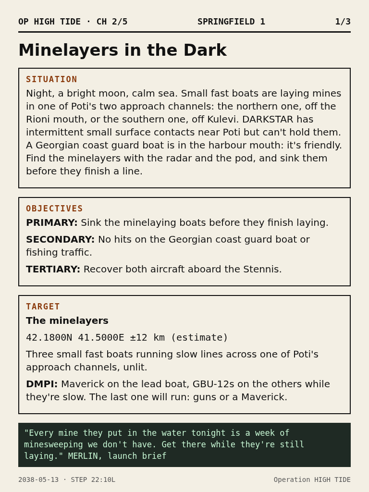</a> <a href="ht_2_minelayers/kneeboard/02_nav.png">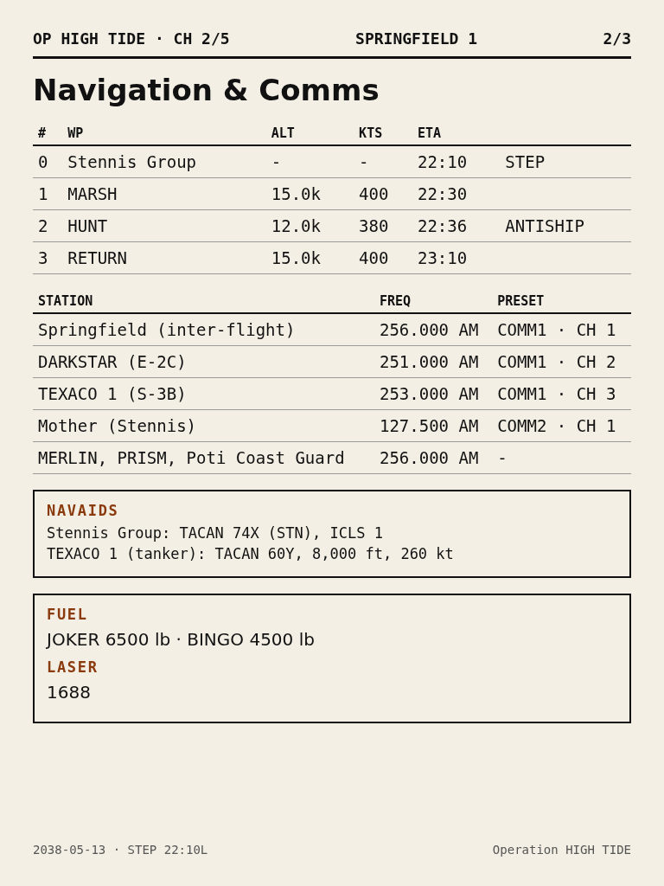</a> <a href="ht_2_minelayers/kneeboard/03_threats.png">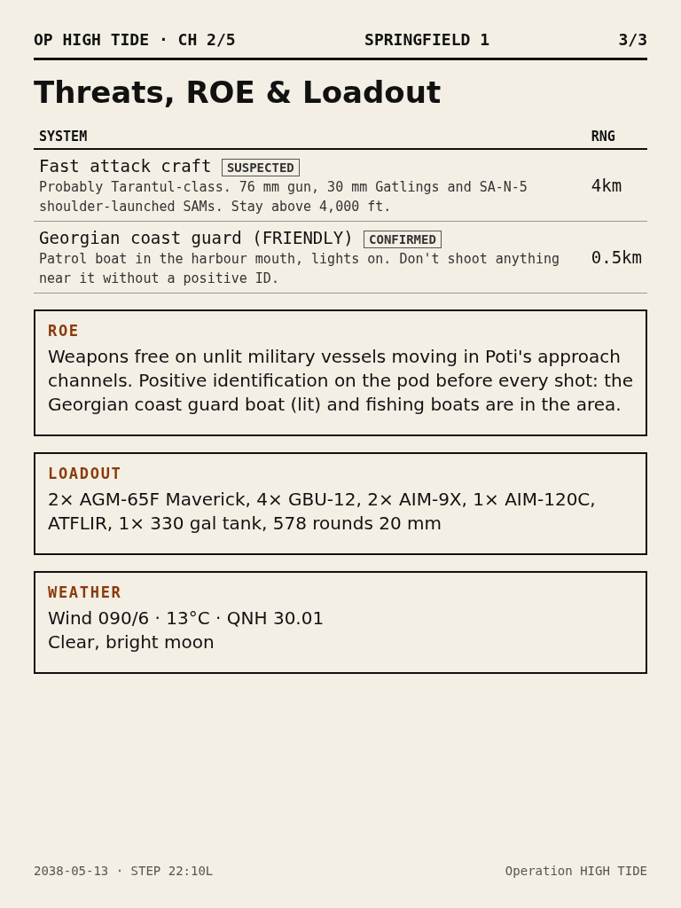</a> 

## HIGH TIDE · 3/5 · Operation HIGH TIDE: Blind the SA-10

**Caucasus** · **2× F/A-18C Hornet** · **SEAD** · 2038-05-15, step 10:15L · Carrier, Air refuelling, Low level

> "It sees everything. That's the problem and the plan. Give it six targets that aren't there and watch it light up to find out which ones are." PRISM, SEAD brief

Poti's channels are open. The night after the minelayers, a Georgian Su-25 looking at the coast north of Anaklia saw a missile come up from the hills behind Ochamchire, from 60 km away. It missed, barely. ELINT confirmed it within the hour: an SA-10, the long-range S-300, moved in to cover the harbour.

**Primary objective:** Destroy the SA-10's track radar.

| Download | |
| --- | --- |
| Mission | [03_ht_3_sa10.miz](campaigns/high_tide/03_ht_3_sa10.miz) |
| Briefing | [briefing.html](ht_3_sa10/briefing.html) |
| Slide deck | [slides.html](ht_3_sa10/slides.html) |
| Director's cut | [director.html](ht_3_sa10/director.html): **spoilers**, for whoever runs or debriefs the mission |

| Kneeboard | [01_mission.png](ht_3_sa10/kneeboard/01_mission.png) · [02_nav.png](ht_3_sa10/kneeboard/02_nav.png) · [03_threats.png](ht_3_sa10/kneeboard/03_threats.png) |

<a href="ht_3_sa10/kneeboard/01_mission.png">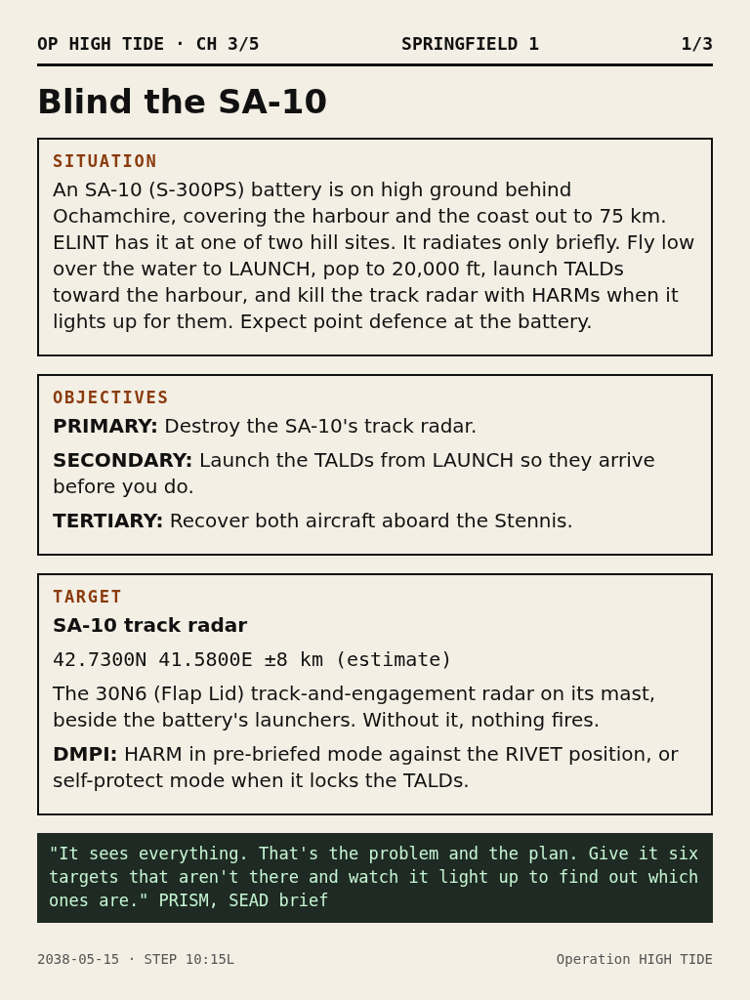</a> <a href="ht_3_sa10/kneeboard/02_nav.png">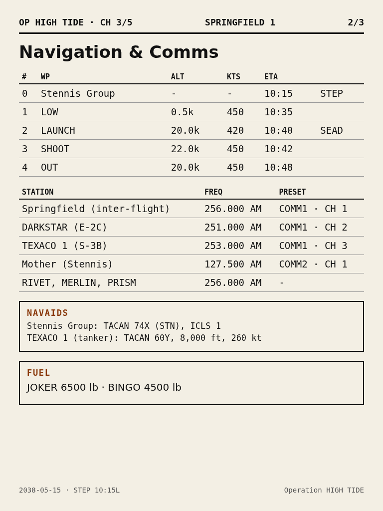</a> <a href="ht_3_sa10/kneeboard/03_threats.png">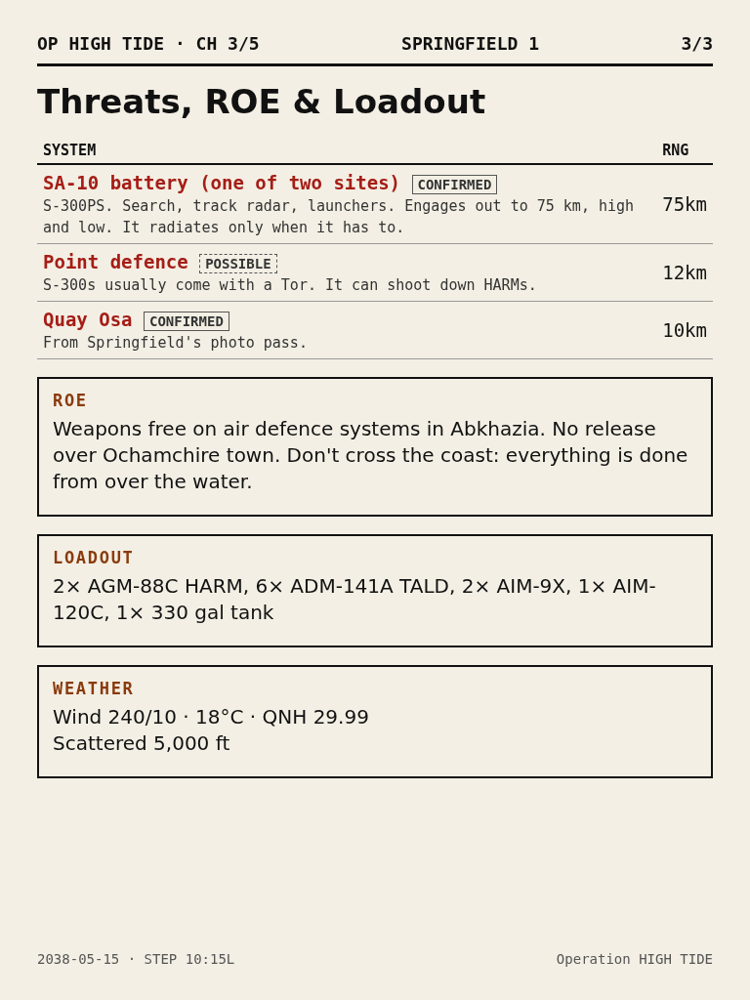</a> 

## HIGH TIDE · 4/5 · Operation HIGH TIDE: Ochamchire Back Door

**Caucasus** · **2× F/A-18C Hornet** · **Anti-ship** · 2038-05-17, step 05:40L · Carrier, Air refuelling, Low level

> "Their guns face the water. So we don't come from the water." MERLIN, strike brief

With the SA-10 blind, Ochamchire is reachable. PRISM's latest picture shows three landing ships alongside the quay now, loading vehicles day and night. Fishing boats report the harbour's guns and SAMs all point out to sea, because that's where everything has come from so far.

**Primary objective:** Sink or disable the landing ships at the Ochamchire quay.

| Download | |
| --- | --- |
| Mission | [04_ht_4_staging.miz](campaigns/high_tide/04_ht_4_staging.miz) |
| Briefing | [briefing.html](ht_4_staging/briefing.html) |
| Slide deck | [slides.html](ht_4_staging/slides.html) |
| Director's cut | [director.html](ht_4_staging/director.html): **spoilers**, for whoever runs or debriefs the mission |

| Kneeboard | [01_mission.png](ht_4_staging/kneeboard/01_mission.png) · [02_nav.png](ht_4_staging/kneeboard/02_nav.png) · [03_threats.png](ht_4_staging/kneeboard/03_threats.png) |

<a href="ht_4_staging/kneeboard/01_mission.png">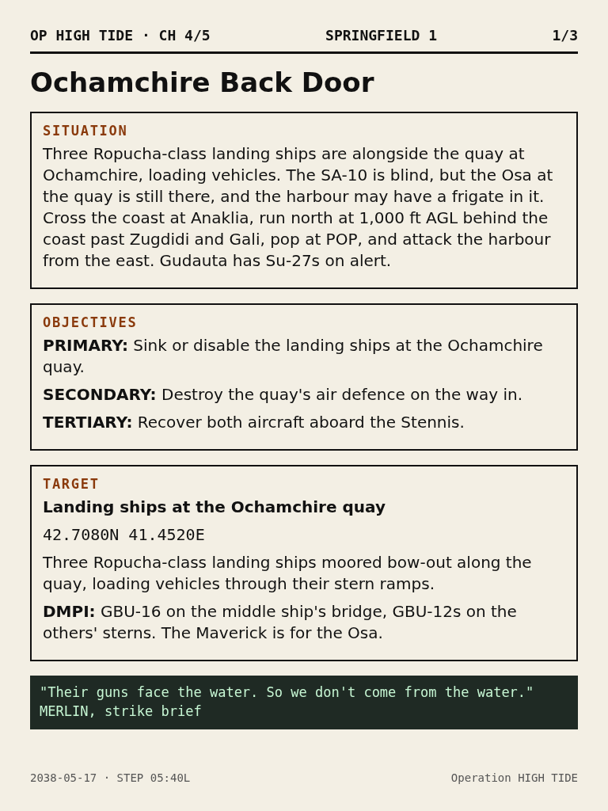</a> <a href="ht_4_staging/kneeboard/02_nav.png">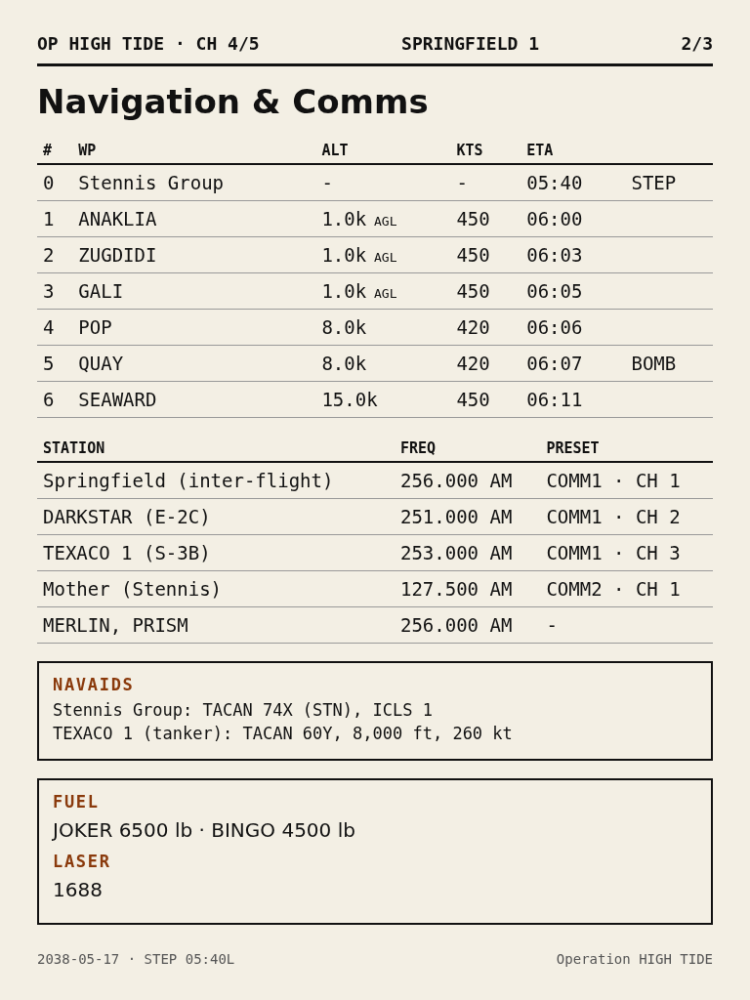</a> <a href="ht_4_staging/kneeboard/03_threats.png">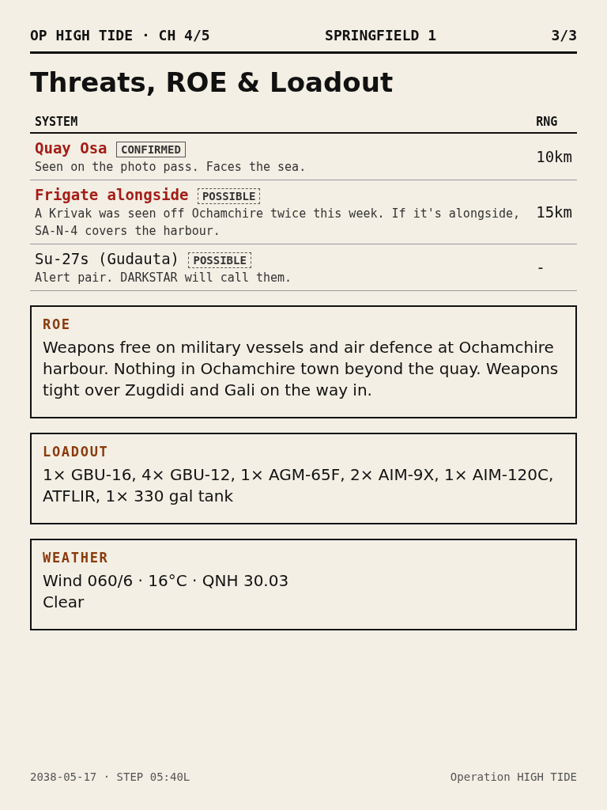</a> 

## HIGH TIDE · 5/5 · Operation HIGH TIDE: Stop the Landing

**Caucasus** · **2× F/A-18C Hornet** · **Anti-ship** · 2038-05-20, step 04:50L · Carrier, Air refuelling

> "If they get to the sand, it's an army's problem for a month. If they don't, it's ours for an hour. Make it ours." MERLIN, 0430 brief

At 0300, Ochamchire emptied. What was left of the landing force, the ship that survived the strike and one that came up from Sochi, sailed south in the dark with a corvette for escort. There's only one beach worth landing on: the long sand at Anaklia, forty kilometres away. At ten knots, they'll be on it at breakfast.

**Primary objective:** Sink both landing ships before they reach the beach at Anaklia.

| Download | |
| --- | --- |
| Mission | [05_ht_5_beachhead.miz](campaigns/high_tide/05_ht_5_beachhead.miz) |
| Briefing | [briefing.html](ht_5_beachhead/briefing.html) |
| Slide deck | [slides.html](ht_5_beachhead/slides.html) |
| Director's cut | [director.html](ht_5_beachhead/director.html): **spoilers**, for whoever runs or debriefs the mission |

| Kneeboard | [01_mission.png](ht_5_beachhead/kneeboard/01_mission.png) · [02_nav.png](ht_5_beachhead/kneeboard/02_nav.png) · [03_threats.png](ht_5_beachhead/kneeboard/03_threats.png) |

<a href="ht_5_beachhead/kneeboard/01_mission.png">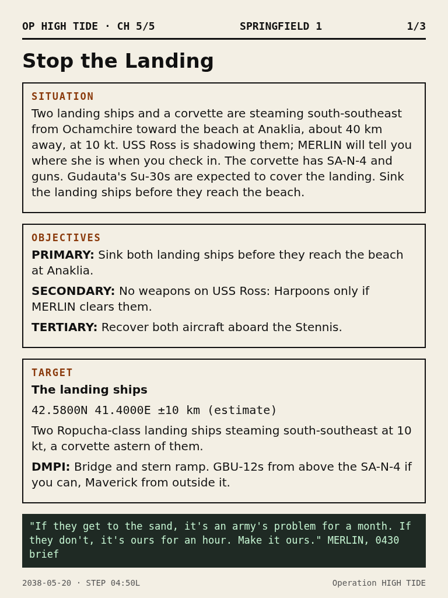</a> <a href="ht_5_beachhead/kneeboard/02_nav.png">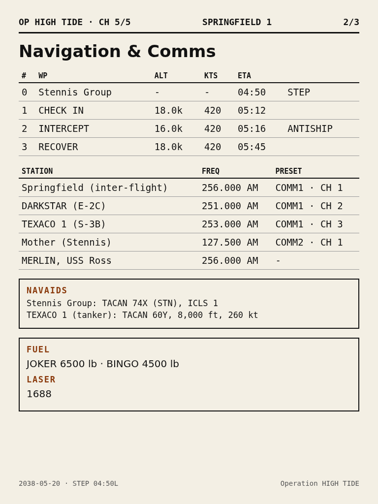</a> <a href="ht_5_beachhead/kneeboard/03_threats.png">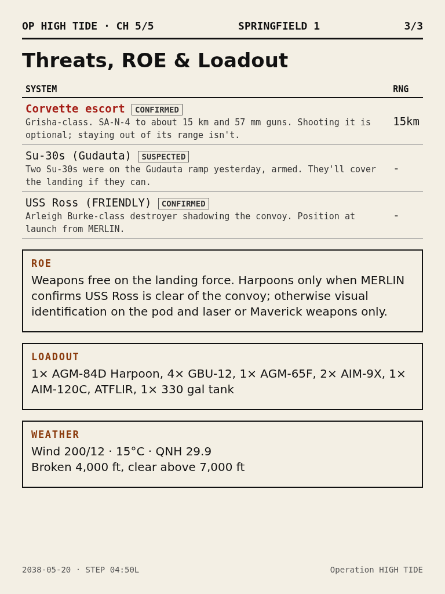</a> 

# IRON GATE campaign

Ten days in the Liakhvi valley, April 2038 5 chapters, 2038-04-06 to 2038-04-16. [Campaign page](campaigns/iron_gate/README.md)

## IRON GATE · 1/5 · Operation IRON GATE: Armed Recce, Liakhvi Valley

**Caucasus** · **2× F/A-18C Hornet** · **Armed recce** · 2038-04-06, step 06:20L

> "Find the front of it. Tell me what it is. If you can stop the first few vehicles, do it. Everything behind them will have to wait." Col. Gelashvili, 0530 phone call

At 0200 the Roki tunnel border post stopped answering the phone. By 0400, Georgian police at Tskhinvali's northern checkpoint were reporting engine noise in the gorge: tracks, a lot of them, coming south. Nobody has seen the column yet. The valley is under cloud, and the drones that went up at first light came back with nothing but grey.

**Primary objective:** Find the column's vanguard and destroy it.

| Download | |
| --- | --- |
| Mission | [01_ig_1_recce.miz](campaigns/iron_gate/01_ig_1_recce.miz) |
| Briefing | [briefing.html](ig_1_recce/briefing.html) |
| Slide deck | [slides.html](ig_1_recce/slides.html) |
| Director's cut | [director.html](ig_1_recce/director.html): **spoilers**, for whoever runs or debriefs the mission |

| Kneeboard | [01_mission.png](ig_1_recce/kneeboard/01_mission.png) · [02_nav.png](ig_1_recce/kneeboard/02_nav.png) · [03_threats.png](ig_1_recce/kneeboard/03_threats.png) |

<a href="ig_1_recce/kneeboard/01_mission.png">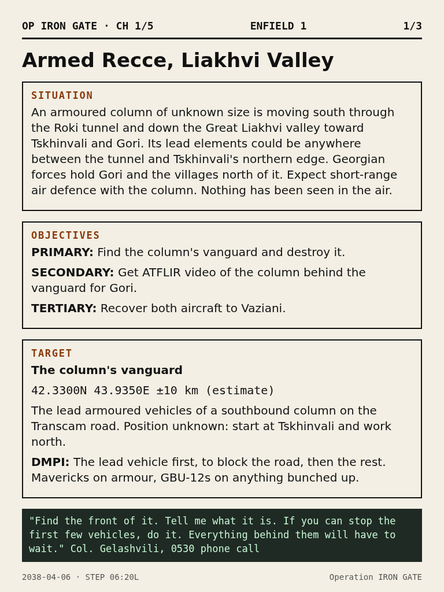</a> <a href="ig_1_recce/kneeboard/02_nav.png">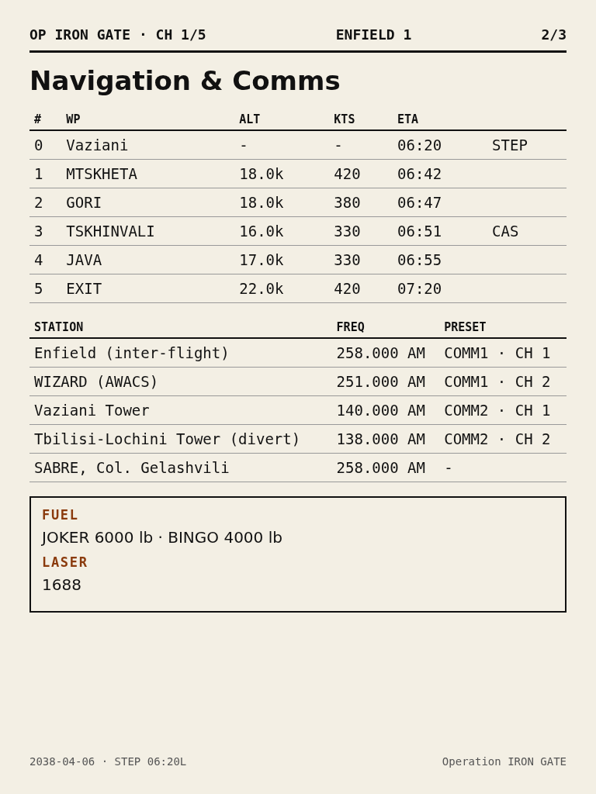</a> <a href="ig_1_recce/kneeboard/03_threats.png">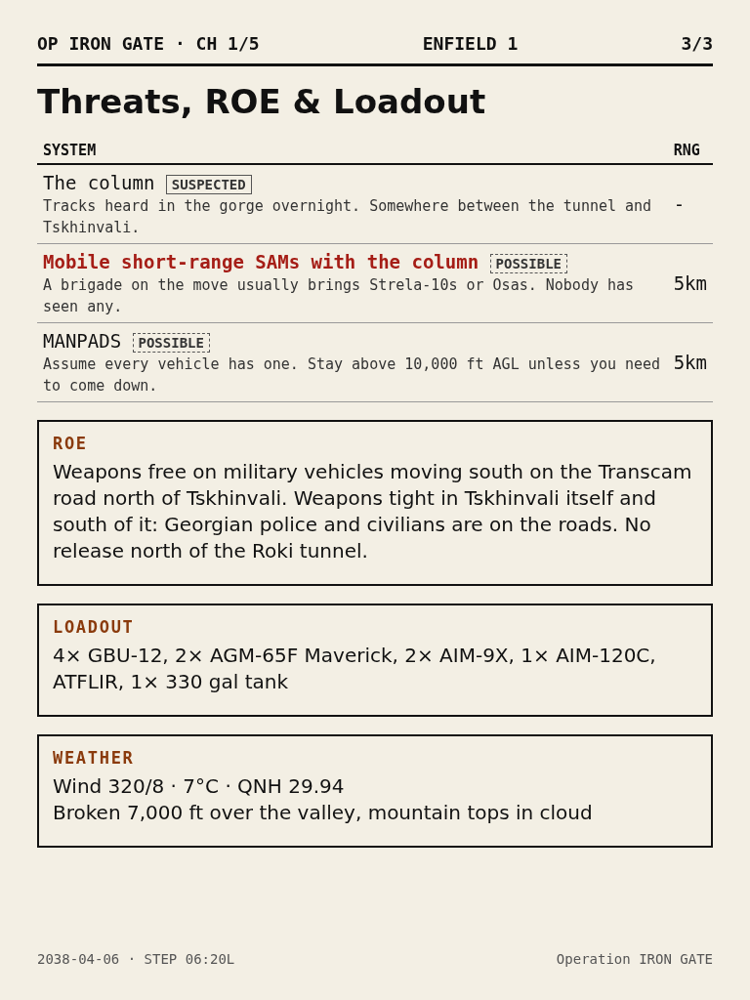</a> 

## IRON GATE · 2/5 · Operation IRON GATE: Drop the Bridges

**Caucasus** · **2× F/A-18C Hornet** · **Strike** · 2038-04-07, step 15:30L · Low level

> "Two bridges. Four bombs. One brigade on the wrong side of them, if you're quick." SABRE, mass brief

Yesterday's tape changed the conversation in Tbilisi. It isn't a raid: it's a mechanized brigade, and its main body is still in the gorge north of Java, waiting for fuel and for the road to clear. Between it and Tskhinvali, the Transcam road crosses the Great Liakhvi twice on two concrete bridges.

**Primary objective:** Destroy both Transcam bridges.

| Download | |
| --- | --- |
| Mission | [02_ig_2_bridges.miz](campaigns/iron_gate/02_ig_2_bridges.miz) |
| Briefing | [briefing.html](ig_2_bridges/briefing.html) |
| Slide deck | [slides.html](ig_2_bridges/slides.html) |
| Director's cut | [director.html](ig_2_bridges/director.html): **spoilers**, for whoever runs or debriefs the mission |

| Kneeboard | [01_mission.png](ig_2_bridges/kneeboard/01_mission.png) · [02_nav.png](ig_2_bridges/kneeboard/02_nav.png) · [03_threats.png](ig_2_bridges/kneeboard/03_threats.png) |

<a href="ig_2_bridges/kneeboard/01_mission.png">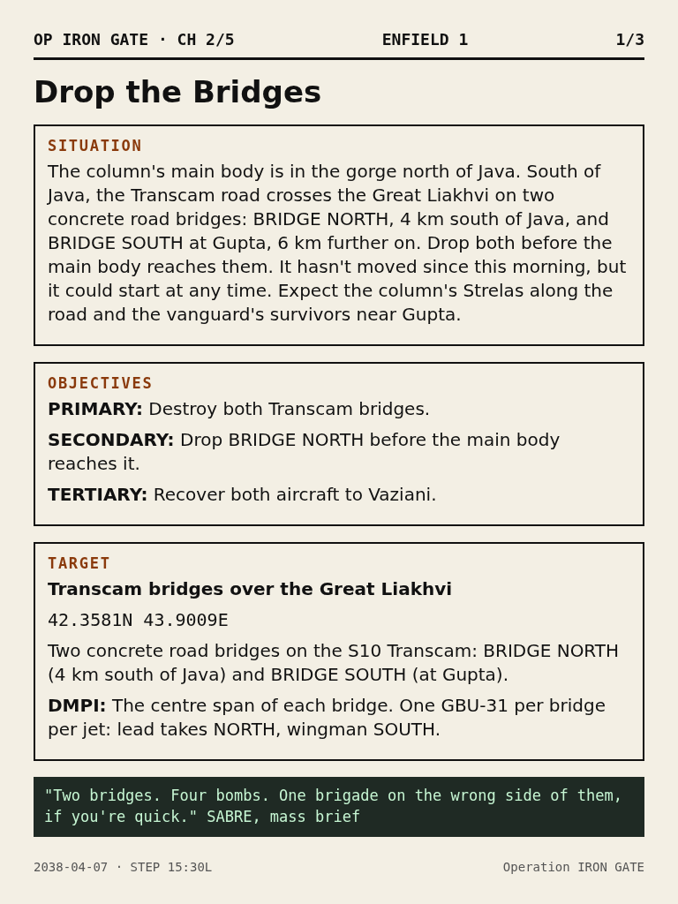</a> <a href="ig_2_bridges/kneeboard/02_nav.png">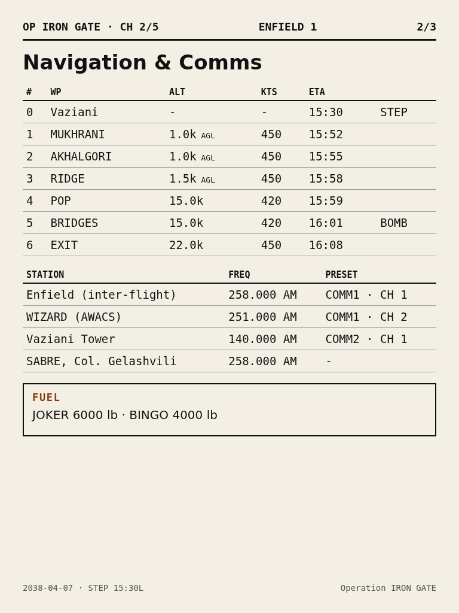</a> <a href="ig_2_bridges/kneeboard/03_threats.png">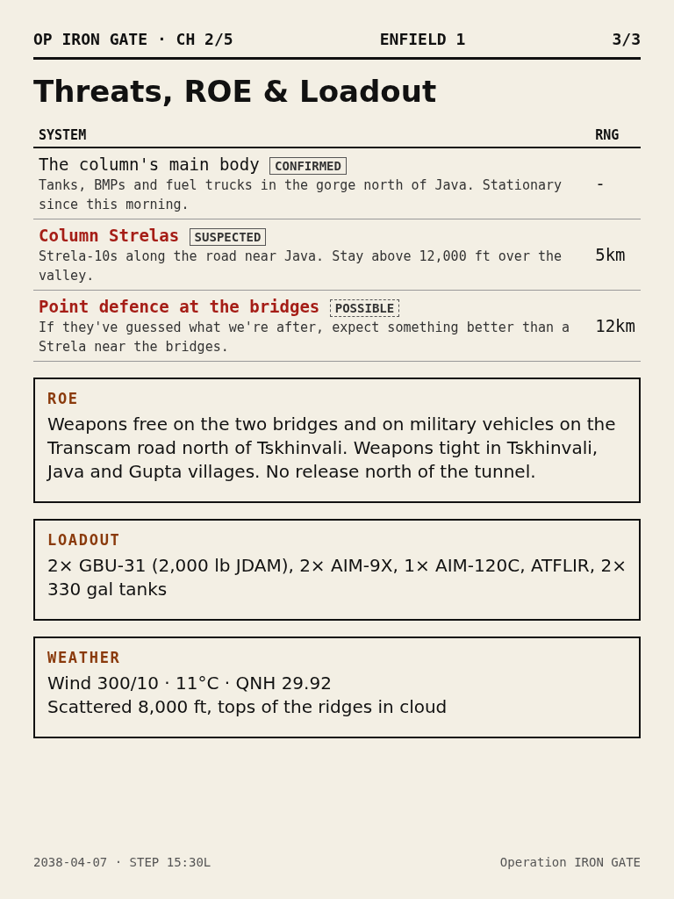</a> 

## IRON GATE · 3/5 · Operation IRON GATE: Hunt the SA-11

**Caucasus** · **2× F/A-18C Hornet** · **SEAD** · 2038-04-09, step 13:40L

> "It's killed one jet already. It's going to be watching the valley for the next one. Don't be the next one. Be the one that comes from the side." SABRE, mass brief

The bridges slowed the column, but they didn't stop it. Engineers had a crossing in by yesterday afternoon, and something came over it with them. Last night a Georgian Su-25 on a recce run up the valley was shot down at 18,000 ft, far above anything a Strela can reach. The pilot's last call was "big radar, big missile."

**Primary objective:** Destroy the SA-11 battery: radar and launchers.

| Download | |
| --- | --- |
| Mission | [03_ig_3_sa11.miz](campaigns/iron_gate/03_ig_3_sa11.miz) |
| Briefing | [briefing.html](ig_3_sa11/briefing.html) |
| Slide deck | [slides.html](ig_3_sa11/slides.html) |
| Director's cut | [director.html](ig_3_sa11/director.html): **spoilers**, for whoever runs or debriefs the mission |

| Kneeboard | [01_mission.png](ig_3_sa11/kneeboard/01_mission.png) · [02_nav.png](ig_3_sa11/kneeboard/02_nav.png) · [03_threats.png](ig_3_sa11/kneeboard/03_threats.png) |

<a href="ig_3_sa11/kneeboard/01_mission.png">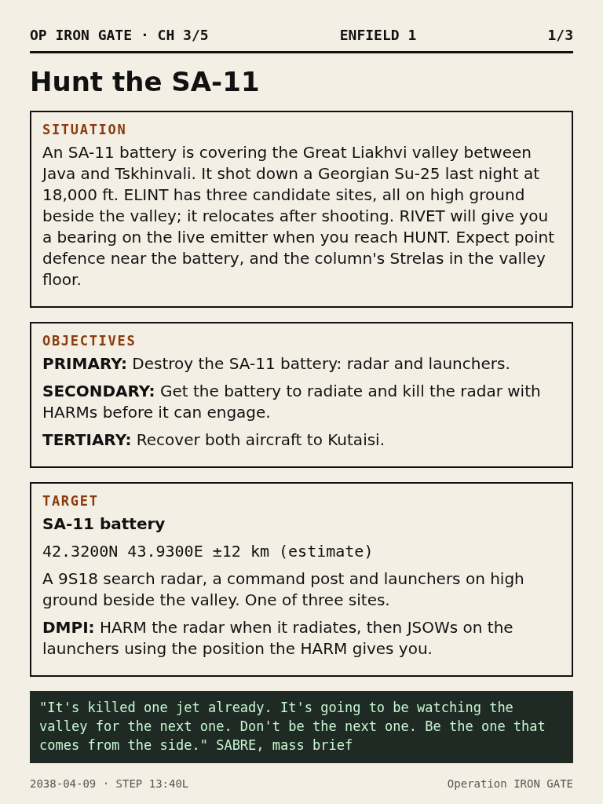</a> <a href="ig_3_sa11/kneeboard/02_nav.png">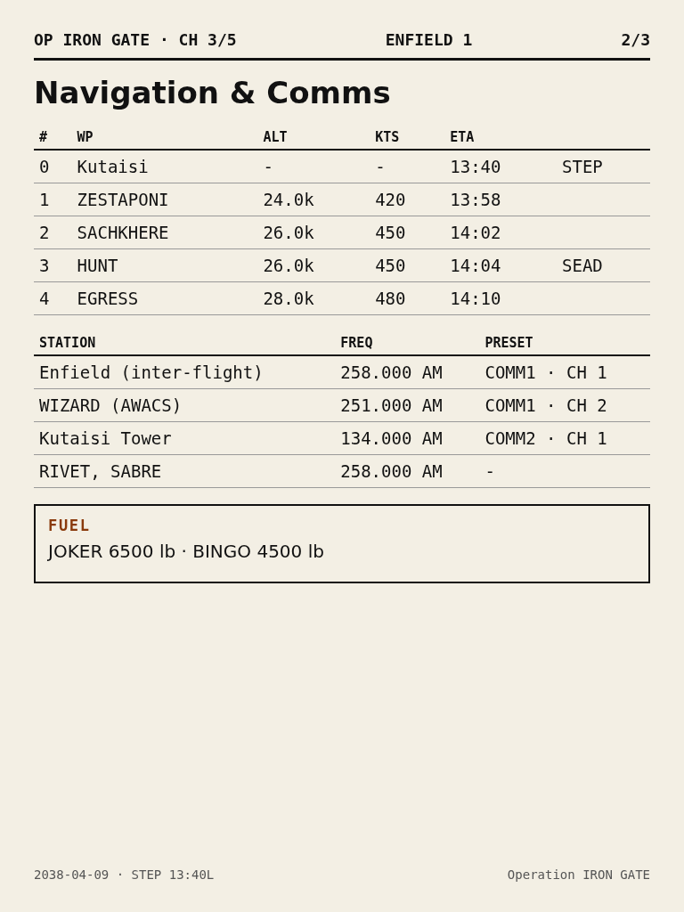</a> <a href="ig_3_sa11/kneeboard/03_threats.png">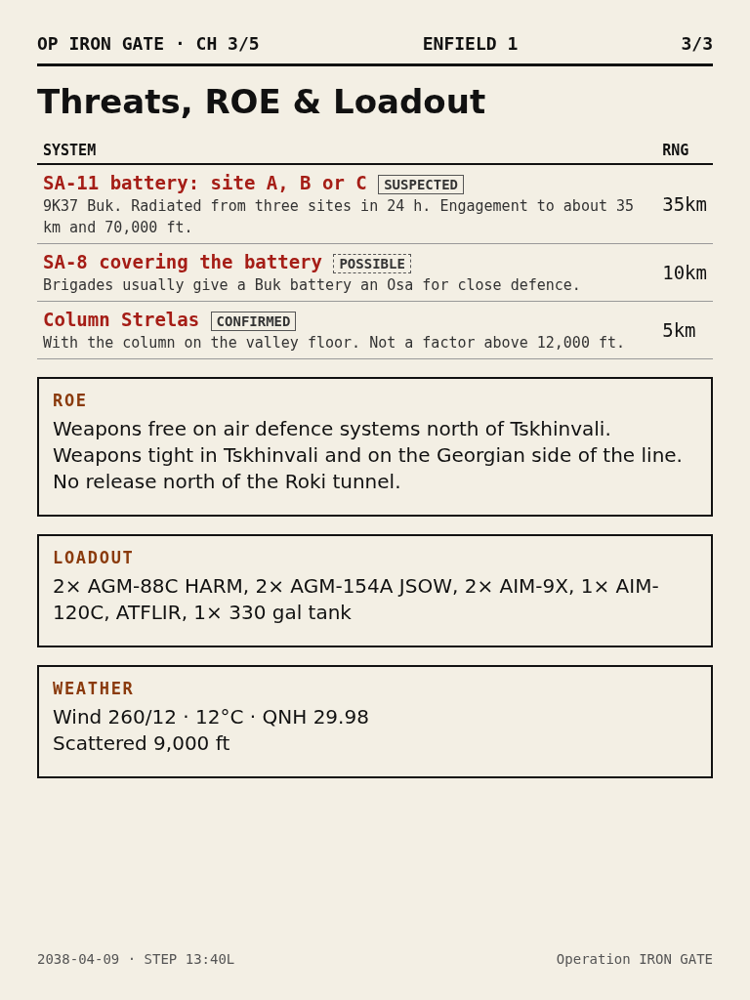</a> 

## IRON GATE · 4/5 · Operation IRON GATE: Hold Gori

**Caucasus** · **2× F/A-18C Hornet** · **CAS** · 2038-04-11, step 09:40L

> "My tanks are the same tanks as their tanks. If you're not sure, ask me. If you're still not sure, don't." HAMMER, on the check-in

With the SA-11 gone, the column did what everyone expected: it came south. By last night its lead battalion was through Tskhinvali and dug in at Ergneti, five kilometres from Gori. The Georgian 4th Brigade holds the northern edge of the town with infantry, a company of T-72s and not much else.

**Primary objective:** Stop the attack before it reaches the Georgian line.

| Download | |
| --- | --- |
| Mission | [04_ig_4_gori_cas.miz](campaigns/iron_gate/04_ig_4_gori_cas.miz) |
| Briefing | [briefing.html](ig_4_gori_cas/briefing.html) |
| Slide deck | [slides.html](ig_4_gori_cas/slides.html) |
| Director's cut | [director.html](ig_4_gori_cas/director.html): **spoilers**, for whoever runs or debriefs the mission |

| Kneeboard | [01_mission.png](ig_4_gori_cas/kneeboard/01_mission.png) · [02_nav.png](ig_4_gori_cas/kneeboard/02_nav.png) · [03_threats.png](ig_4_gori_cas/kneeboard/03_threats.png) |

<a href="ig_4_gori_cas/kneeboard/01_mission.png">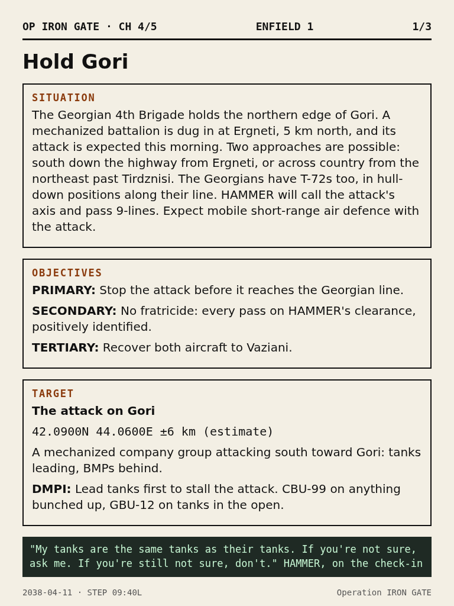</a> <a href="ig_4_gori_cas/kneeboard/02_nav.png">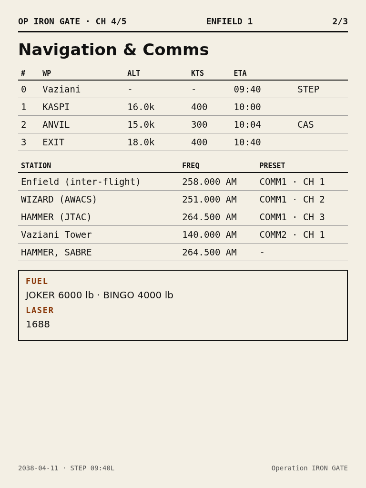</a> <a href="ig_4_gori_cas/kneeboard/03_threats.png">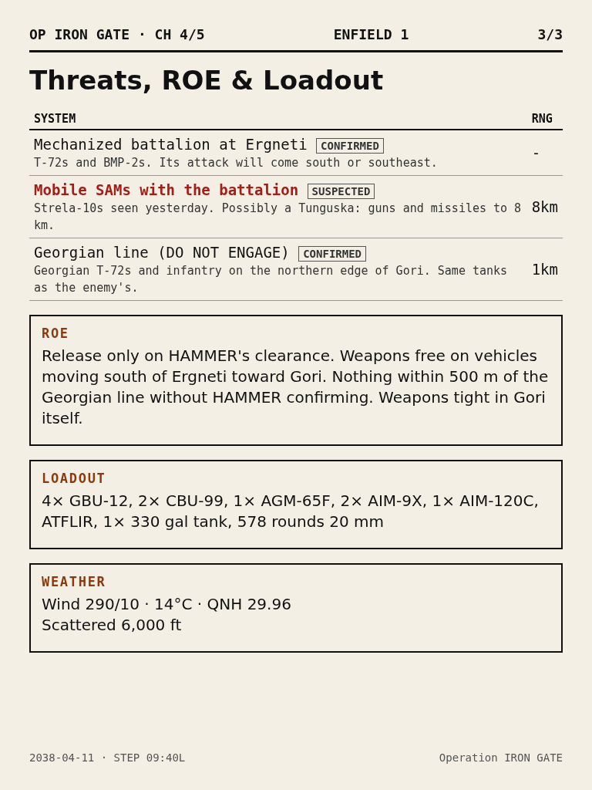</a> 

## IRON GATE · 5/5 · Operation IRON GATE: Close the Gate

**Caucasus** · **2× F/A-18C Hornet** · **Strike** · 2038-04-16, step 10:50L · Different recovery field

> "Everything they have came through that tunnel. Everything they need still has to. Close it." Col. Gelashvili, by phone to Vaziani

Gori held, and the northern brigade has run out of ways forward. It still has tanks in Tskhinvali and an attack battalion licking its wounds at Ergneti, but everything it needs to keep fighting comes through one tunnel and stops at one dump: a field of fuel trucks and ammunition south of Java.

**Primary objective:** Destroy the supply dump south of Java.

| Download | |
| --- | --- |
| Mission | [05_ig_5_gate.miz](campaigns/iron_gate/05_ig_5_gate.miz) |
| Briefing | [briefing.html](ig_5_gate/briefing.html) |
| Slide deck | [slides.html](ig_5_gate/slides.html) |
| Director's cut | [director.html](ig_5_gate/director.html): **spoilers**, for whoever runs or debriefs the mission |

| Kneeboard | [01_mission.png](ig_5_gate/kneeboard/01_mission.png) · [02_nav.png](ig_5_gate/kneeboard/02_nav.png) · [03_threats.png](ig_5_gate/kneeboard/03_threats.png) |

<a href="ig_5_gate/kneeboard/01_mission.png">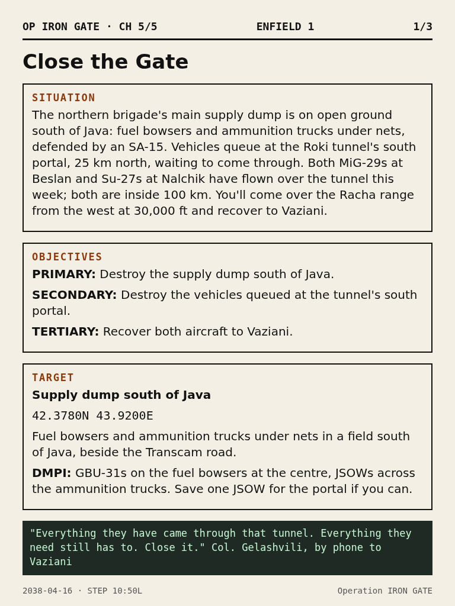</a> <a href="ig_5_gate/kneeboard/02_nav.png">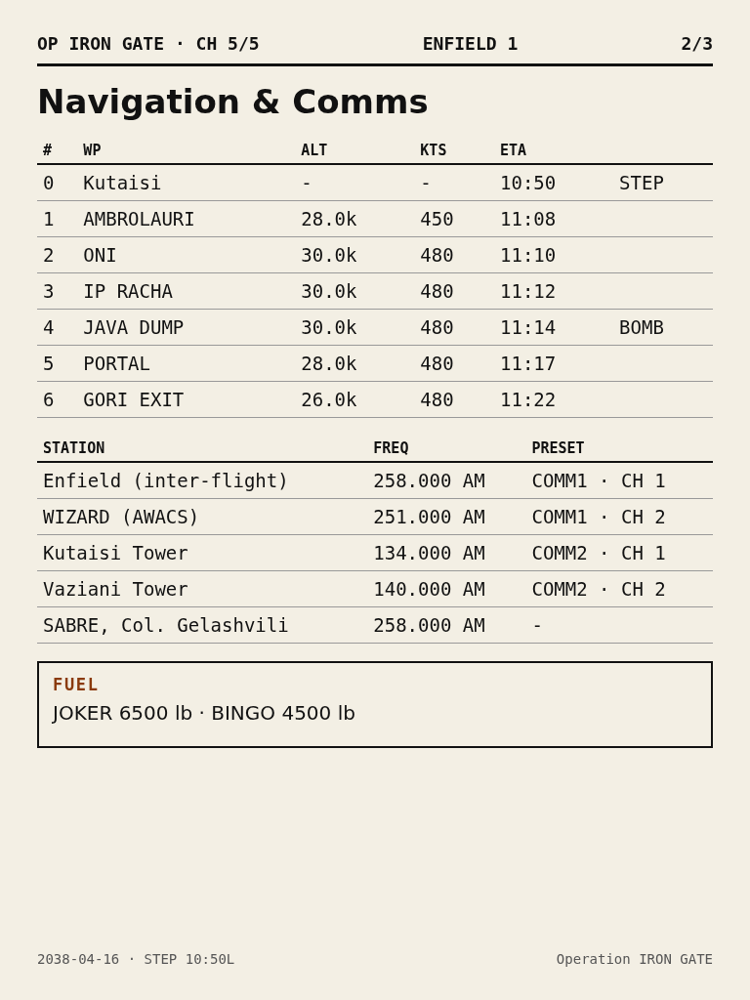</a> <a href="ig_5_gate/kneeboard/03_threats.png">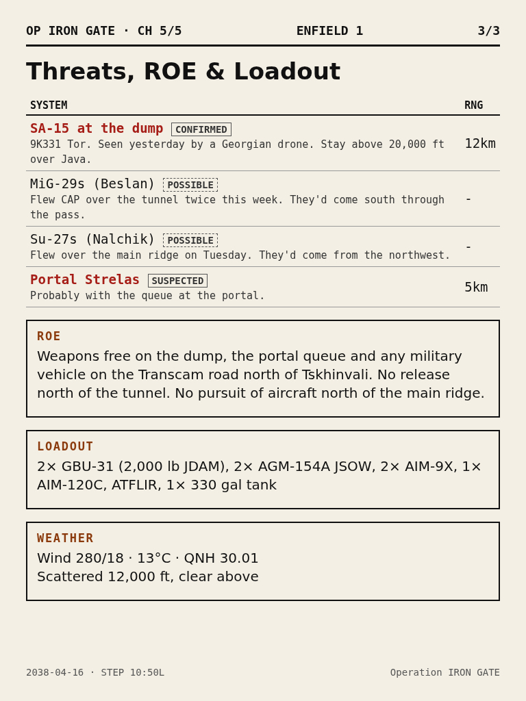</a> 

# WORK-UPS campaign

Hornet detachment syllabus, January 2038 5 chapters, 2038-01-15 to 2038-01-30. [Campaign page](campaigns/workups/README.md)

## WORK-UPS · 1/5 · Training · Det work-ups, event CQ-1: Day Carrier Qualification

**Caucasus** · **1× F/A-18C Hornet** · **Carrier quals** · 2038-01-15, step 12:30L · Carrier, Air refuelling, Low level, Different recovery field

> "Fly the ball all the way to the deck. If I wave you off, you go around, every time. The boat isn't going anywhere, but it is moving." PADDLES, LSO brief

The detachment landed at Kutaisi last week with ten Hornets and a February partner exercise to get ready for. The USS John C. Stennis is passing through the eastern Black Sea for a port call, and the strike group has agreed to keep a deck open for the detachment for one afternoon. The Hornets are land-based for this deployment, but every pilot has to stay current at the boat, and the February exercise will have carrier play.

**Primary objective:** Two arrested landings aboard the Stennis, with a catapult launch between them.

| Download | |
| --- | --- |
| Mission | [01_wu_1_cq_day.miz](campaigns/workups/01_wu_1_cq_day.miz) |
| Briefing | [briefing.html](wu_1_cq_day/briefing.html) |
| Slide deck | [slides.html](wu_1_cq_day/slides.html) |
| Instructor view | [director.html](wu_1_cq_day/director.html): every trigger and how each grade is decided |

| Kneeboard | [01_mission.png](wu_1_cq_day/kneeboard/01_mission.png) · [02_nav.png](wu_1_cq_day/kneeboard/02_nav.png) · [03_rules.png](wu_1_cq_day/kneeboard/03_rules.png) |

<a href="wu_1_cq_day/kneeboard/01_mission.png">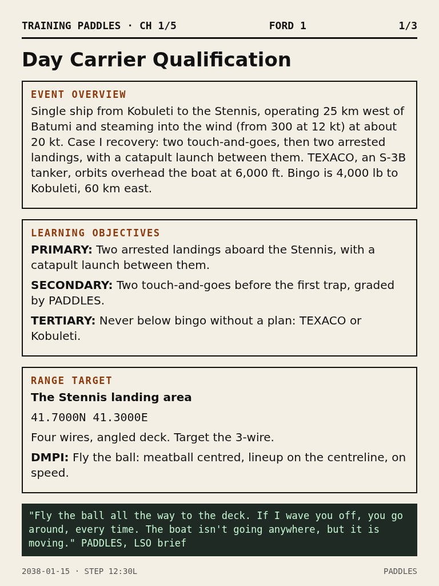</a> <a href="wu_1_cq_day/kneeboard/02_nav.png">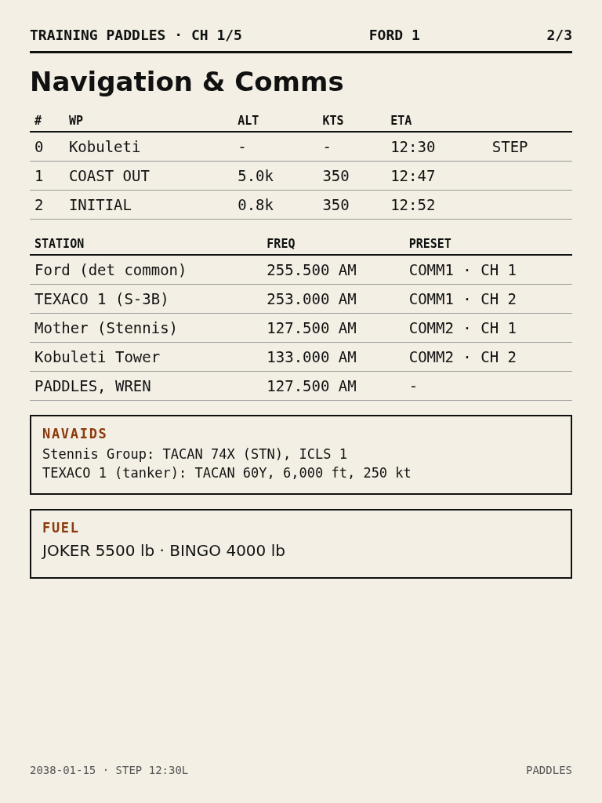</a> <a href="wu_1_cq_day/kneeboard/03_rules.png">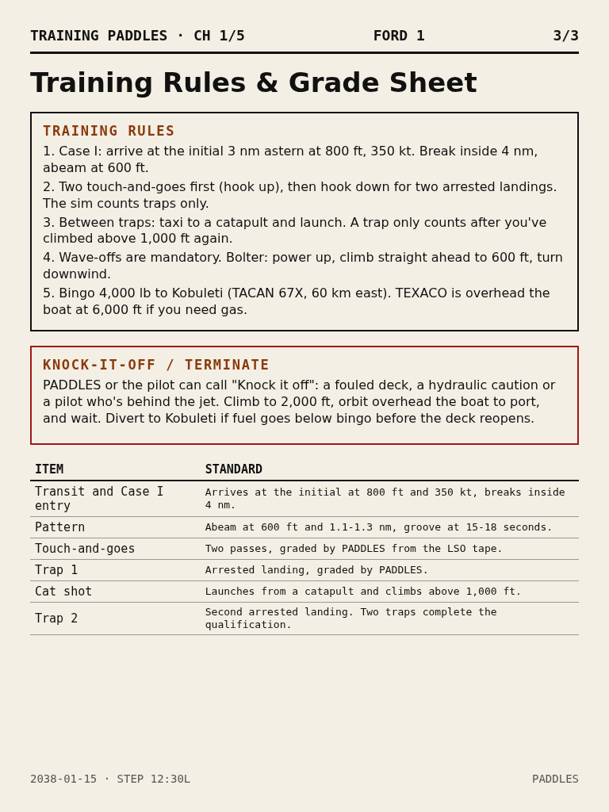</a> 

## WORK-UPS · 2/5 · Training · Det work-ups, event CQ-2: Night Carrier Qualification

**Caucasus** · **1× F/A-18C Hornet** · **Carrier quals** · 2038-01-16, step 18:45L · Carrier, Air refuelling

> "At night, the deck doesn't get bigger as you get closer. It just gets darker around it. Fly the needles." PADDLES, night brief

The day traps went well enough that the strike group gave the detachment the deck again, after dark. Night quals are the hardest landings in naval aviation: no horizon, a small lit rectangle moving at 15 knots, and the knowledge that the only alternate is 60 km away.

**Primary objective:** Two night arrested landings aboard the Stennis.

| Download | |
| --- | --- |
| Mission | [02_wu_2_cq_night.miz](campaigns/workups/02_wu_2_cq_night.miz) |
| Briefing | [briefing.html](wu_2_cq_night/briefing.html) |
| Slide deck | [slides.html](wu_2_cq_night/slides.html) |
| Instructor view | [director.html](wu_2_cq_night/director.html): every trigger and how each grade is decided |

| Kneeboard | [01_mission.png](wu_2_cq_night/kneeboard/01_mission.png) · [02_nav.png](wu_2_cq_night/kneeboard/02_nav.png) · [03_rules.png](wu_2_cq_night/kneeboard/03_rules.png) |

 <a href="wu_2_cq_night/kneeboard/02_nav.png">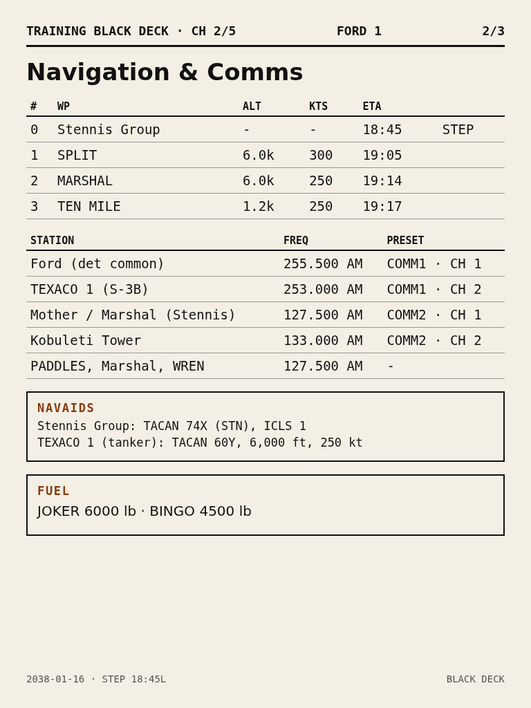</a> <a href="wu_2_cq_night/kneeboard/03_rules.png">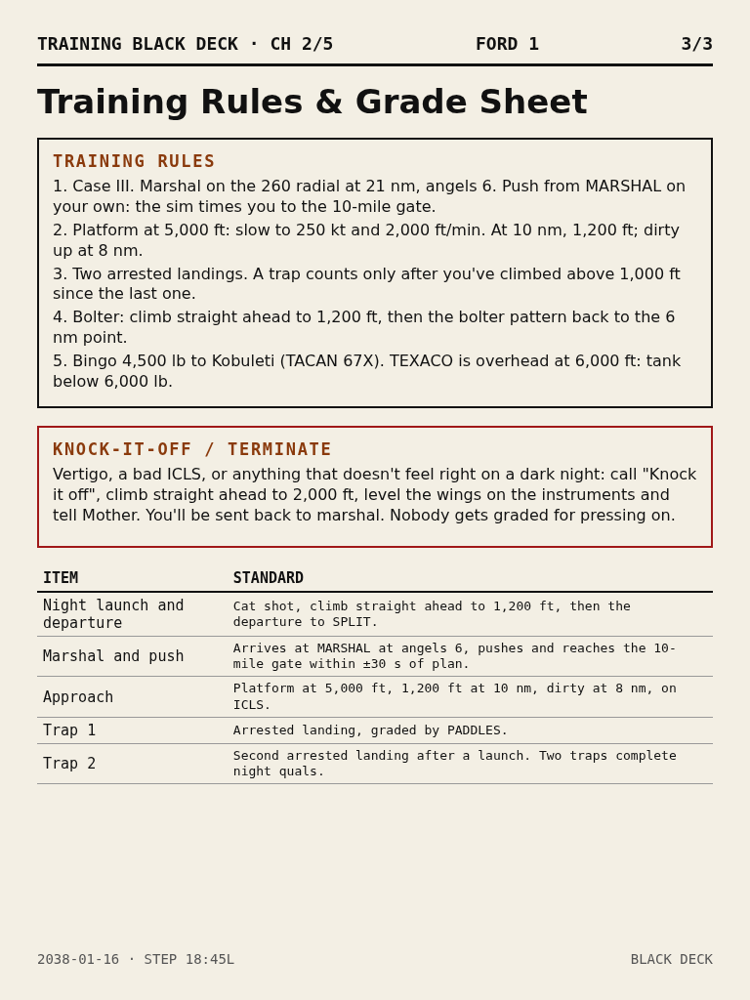</a> 

## WORK-UPS · 3/5 · Training · Det work-ups, event SEAD-1: SEAD Fundamentals

**Caucasus** · **1× F/A-18C Hornet** · **SEAD** · 2038-01-20, step 10:00L

> "Those radars have been looking at people like you for forty years. Today you get to answer back. Twice. On time." WREN, SEAD brief

The Georgian Air Defence Command keeps a captured SA-6 battery and an SA-8 on the steppe east of the Gareja range for exactly this: letting allied crews hear a real Soviet-era radar on the RWR and shoot it. Today they've agreed to let the detachment put two live HARMs into the old radars. The launchers stay; the radars were due to be scrapped anyway.

**Primary objective:** Destroy the SA-6 radar and the SA-8 with one HARM each.

| Download | |
| --- | --- |
| Mission | [03_wu_3_sead.miz](campaigns/workups/03_wu_3_sead.miz) |
| Briefing | [briefing.html](wu_3_sead/briefing.html) |
| Slide deck | [slides.html](wu_3_sead/slides.html) |
| Instructor view | [director.html](wu_3_sead/director.html): every trigger and how each grade is decided |

| Kneeboard | [01_mission.png](wu_3_sead/kneeboard/01_mission.png) · [02_nav.png](wu_3_sead/kneeboard/02_nav.png) · [03_rules.png](wu_3_sead/kneeboard/03_rules.png) |

<a href="wu_3_sead/kneeboard/01_mission.png">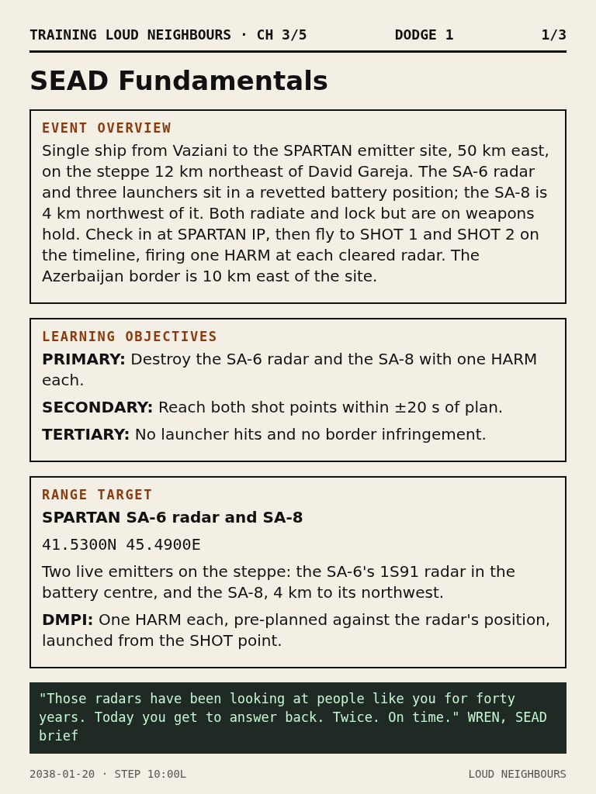</a> <a href="wu_3_sead/kneeboard/02_nav.png">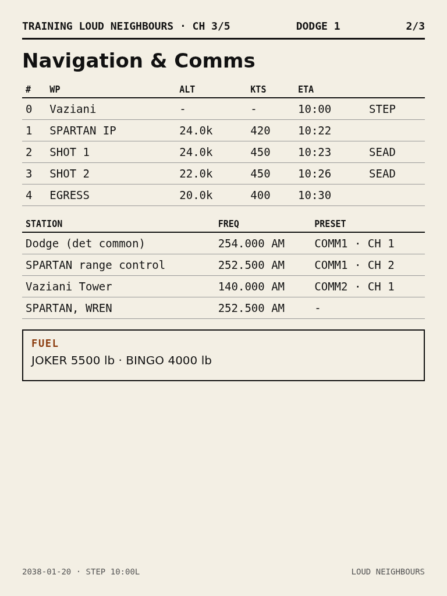</a> <a href="wu_3_sead/kneeboard/03_rules.png">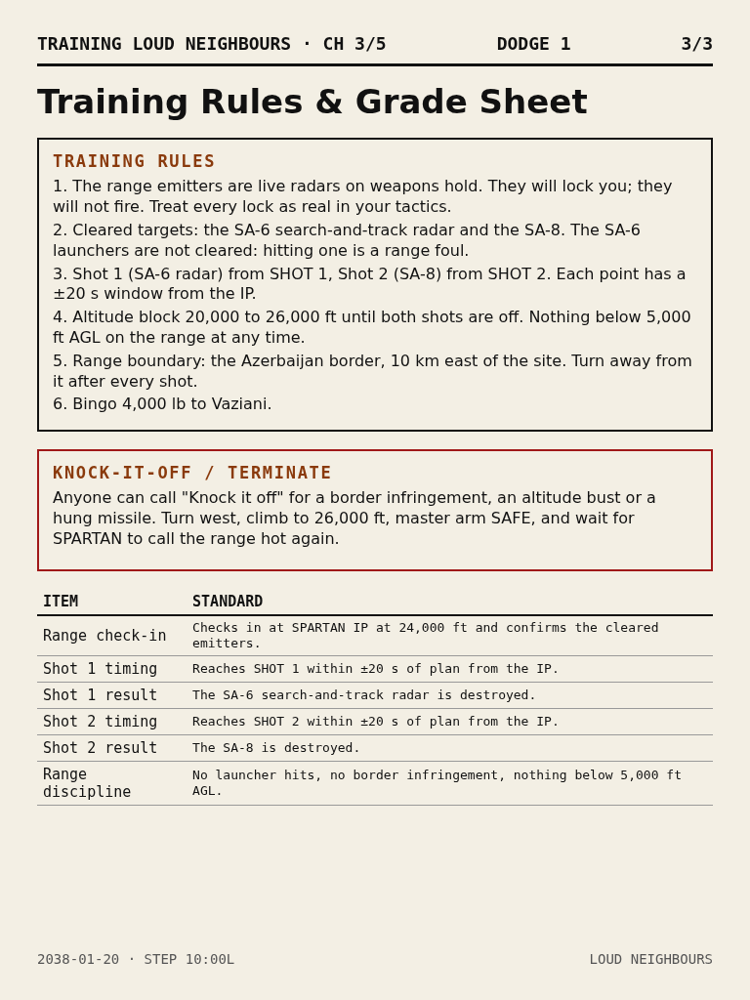</a> 

## WORK-UPS · 4/5 · Training · Det work-ups, event CAS-1: Close Air Support with a JTAC

**Caucasus** · **1× F/A-18C Hornet** · **CAS** · 2038-01-22, step 13:15L

> "I'll tell you where to look. I'll tell you when to shoot. If I say abort, you're already pulling off." AXEMAN, CAS brief

The Georgian 2nd Infantry Brigade is on a field exercise south of the Gareja range, and they've offered their joint terminal attack controllers to the detachment for an afternoon. The rules are simple: they'll pretend to be in contact, put old vehicles out as the enemy, and talk you onto them the way they would in a real fight. Their own platoon will be sitting right next to the targets.

**Primary objective:** Destroy both target groups on AXEMAN's clearance.

| Download | |
| --- | --- |
| Mission | [04_wu_4_jtac.miz](campaigns/workups/04_wu_4_jtac.miz) |
| Briefing | [briefing.html](wu_4_jtac/briefing.html) |
| Slide deck | [slides.html](wu_4_jtac/slides.html) |
| Instructor view | [director.html](wu_4_jtac/director.html): every trigger and how each grade is decided |

| Kneeboard | [01_mission.png](wu_4_jtac/kneeboard/01_mission.png) · [02_nav.png](wu_4_jtac/kneeboard/02_nav.png) · [03_rules.png](wu_4_jtac/kneeboard/03_rules.png) |

<a href="wu_4_jtac/kneeboard/01_mission.png">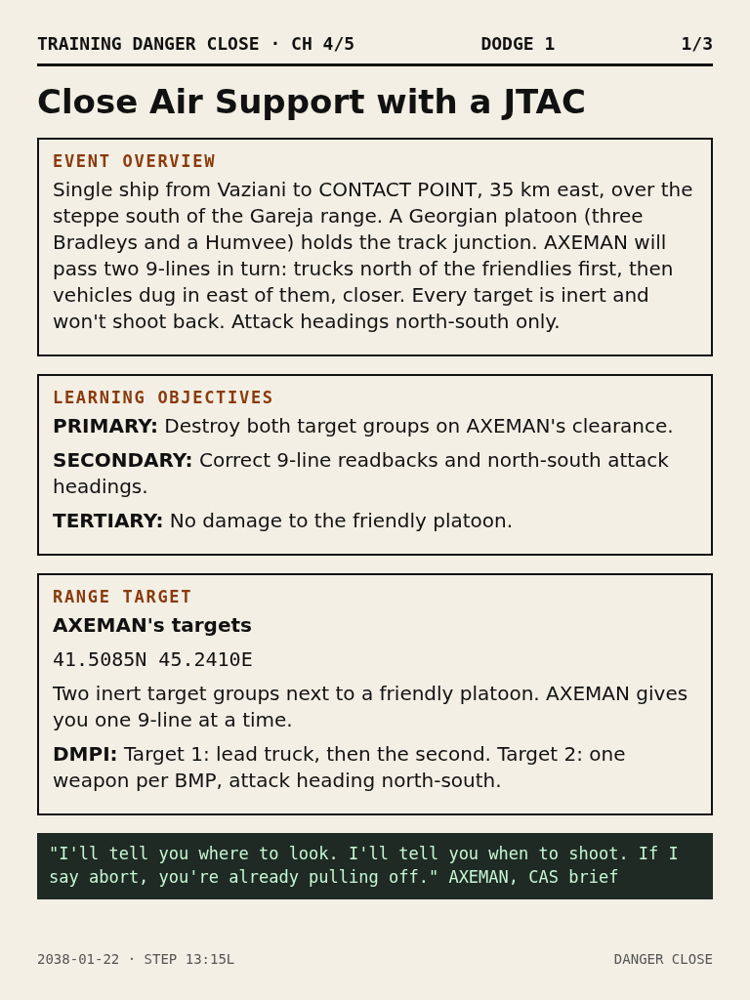</a> <a href="wu_4_jtac/kneeboard/02_nav.png">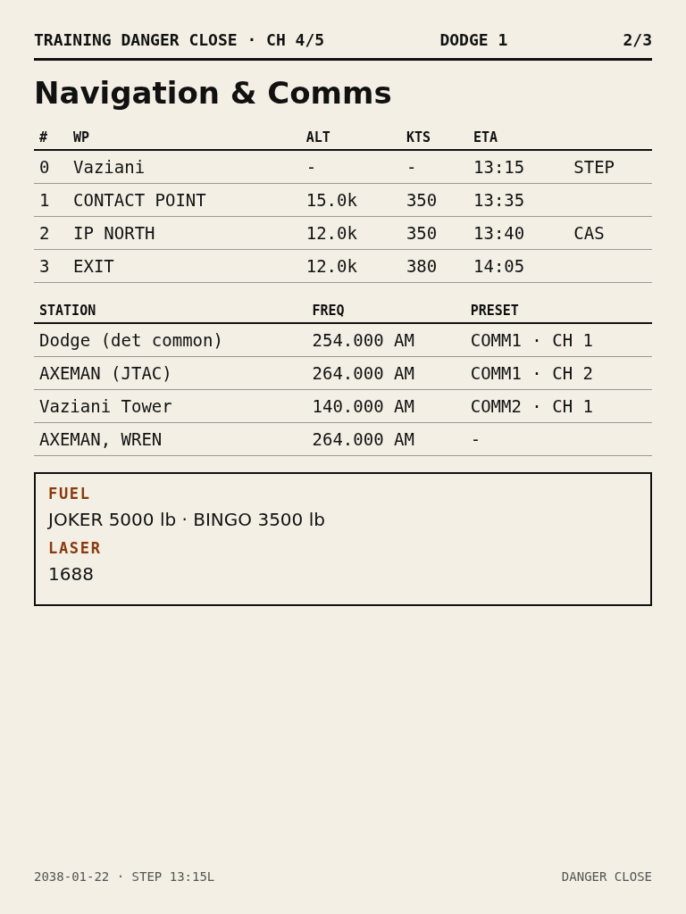</a> <a href="wu_4_jtac/kneeboard/03_rules.png">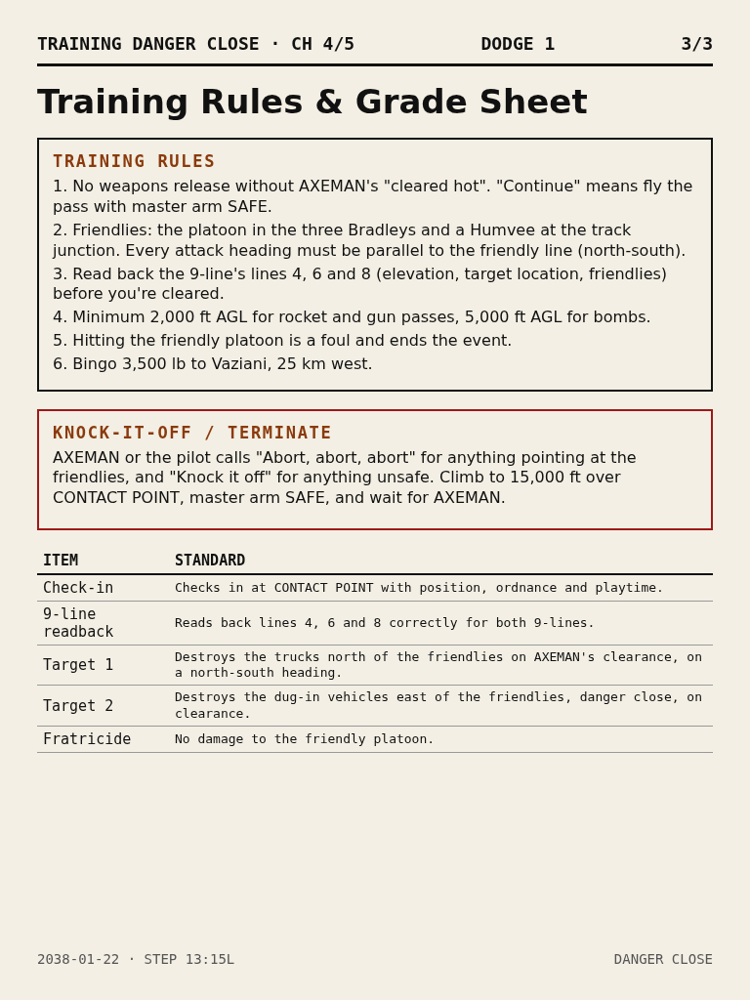</a> 

## WORK-UPS · 5/5 · Training · Det work-ups, event COMPEX-1 (checkride): Graduation Composite Exercise

**Caucasus** · **2× F/A-18C Hornet** · **Strike (package)** · 2038-01-30, step 09:30L

> "I'm not grading the bombs. I'm grading whether the bombs land when you said they would, with everyone still alive." WREN, checkride brief

This is the last event of work-ups and the one WREN signs the whole card on. It puts everything from the last three weeks into one sortie: a package that has to arrive together, an emitter that has to be suppressed, aggressors that want to break it up, and a target that has to be hit on time.

**Primary objective:** Destroy the target set with JDAMs inside the TOT window.

| Download | |
| --- | --- |
| Mission | [05_wu_5_compex.miz](campaigns/workups/05_wu_5_compex.miz) |
| Briefing | [briefing.html](wu_5_compex/briefing.html) |
| Slide deck | [slides.html](wu_5_compex/slides.html) |
| Instructor view | [director.html](wu_5_compex/director.html): every trigger and how each grade is decided |

| Kneeboard | [01_mission.png](wu_5_compex/kneeboard/01_mission.png) · [02_nav.png](wu_5_compex/kneeboard/02_nav.png) · [03_rules.png](wu_5_compex/kneeboard/03_rules.png) |

<a href="wu_5_compex/kneeboard/01_mission.png">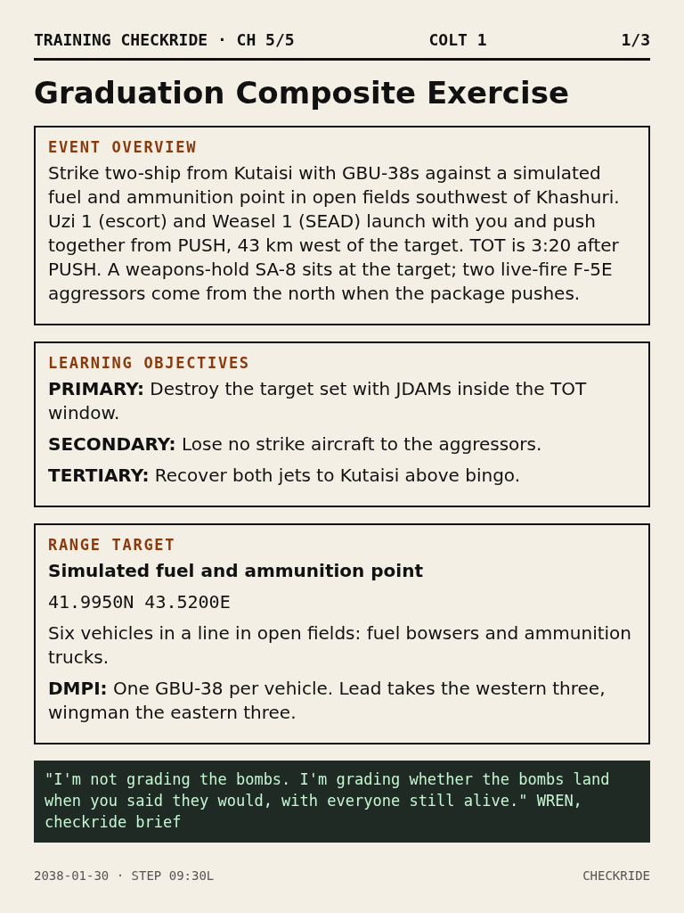</a> <a href="wu_5_compex/kneeboard/02_nav.png">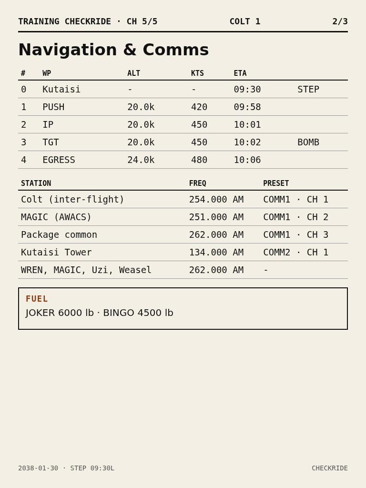</a> <a href="wu_5_compex/kneeboard/03_rules.png">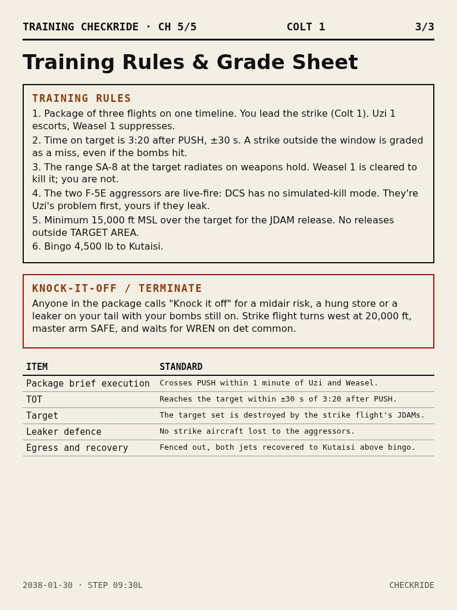</a> 

# Standalone operations

The Black Sea missions, to fly in any order. Briefings carry only what the squadron knows, and the sim decides the rest.

## Operation BROKEN SPAN: Strike on the Bzyb River Bridge

**Caucasus** · **2× F/A-18C Hornet** · **Strike** · 2038-03-14, step 06:40L

> "Gentlemen, there's one bridge between that brigade and Sukhumi. By breakfast I want it in the river." HATCH Moreno, 0500 brief

Three weeks ago a ceasefire along the Inguri line collapsed. Separatist forces, re-equipped with modern air defences and backed by Russian advisers, have been pushing armour south down the coastal M-27 highway toward Sukhumi. The coalition has held them at the Gumista, but intelligence shows a fresh mechanised brigade staging near Gagra for a push within 36 hours.

**Primary objective:** Destroy the Bzyb River road bridge.

| Download | |
| --- | --- |
| Mission | [gudauta_bridge.miz](gudauta_bridge/gudauta_bridge.miz) |
| Briefing | [briefing.html](gudauta_bridge/briefing.html) |
| Slide deck | [slides.html](gudauta_bridge/slides.html) |
| Director's cut | [director.html](gudauta_bridge/director.html): **spoilers**, for whoever runs or debriefs the mission |

| Kneeboard | [01_mission.png](gudauta_bridge/kneeboard/01_mission.png) · [02_nav.png](gudauta_bridge/kneeboard/02_nav.png) · [03_threats.png](gudauta_bridge/kneeboard/03_threats.png) |

<a href="gudauta_bridge/kneeboard/01_mission.png">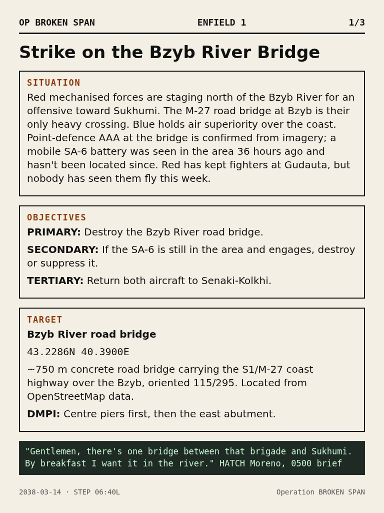</a> <a href="gudauta_bridge/kneeboard/02_nav.png">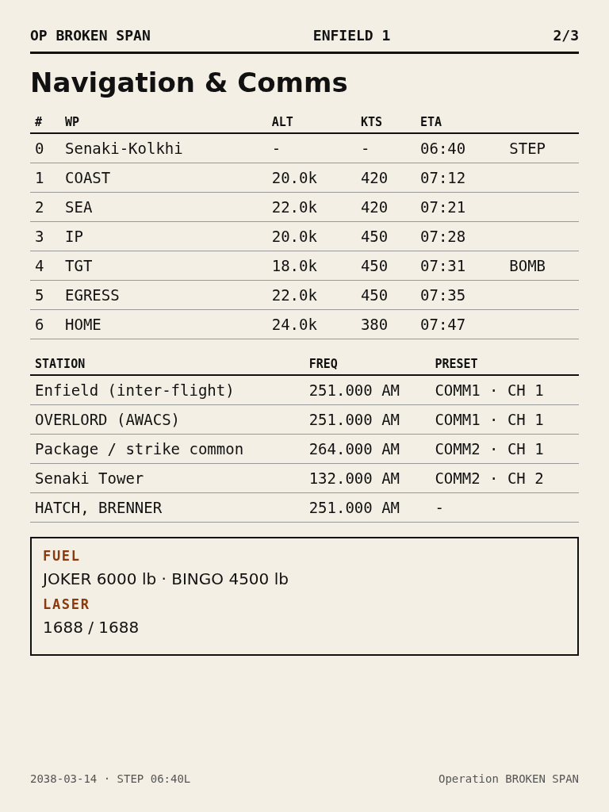</a> <a href="gudauta_bridge/kneeboard/03_threats.png">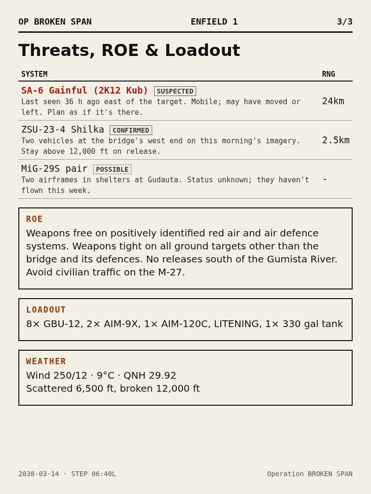</a> 

## Operation SILENT ORCHARD: Find the SA-11

**Caucasus** · **2× F-16C Viper** · **SEAD** · 2038-03-16, step 14:20L

> "It's out there, it already has one kill, and it's patient. Make it talk, then make it stop." Lt Kapanadze, 1300 brief

Two days after the strike on the Bzyb bridge, the separatists answered. Yesterday at 1410 a coalition MQ-9, MAGPIE 3, went silent over the hills above New Athos. Its last telemetry frame shows a 9S18 search radar locking it up from somewhere in the orchards below.

**Primary objective:** Locate and destroy or disable the SA-11 battery (search radar and launchers).

| Download | |
| --- | --- |
| Mission | [silent_orchard.miz](silent_orchard/silent_orchard.miz) |
| Briefing | [briefing.html](silent_orchard/briefing.html) |
| Slide deck | [slides.html](silent_orchard/slides.html) |
| Director's cut | [director.html](silent_orchard/director.html): **spoilers**, for whoever runs or debriefs the mission |

| Kneeboard | [01_mission.png](silent_orchard/kneeboard/01_mission.png) · [02_nav.png](silent_orchard/kneeboard/02_nav.png) · [03_threats.png](silent_orchard/kneeboard/03_threats.png) |

<a href="silent_orchard/kneeboard/01_mission.png">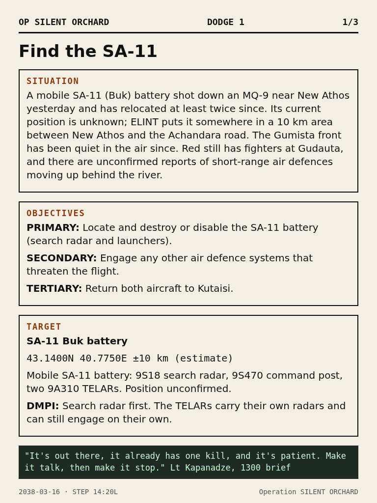</a> <a href="silent_orchard/kneeboard/02_nav.png">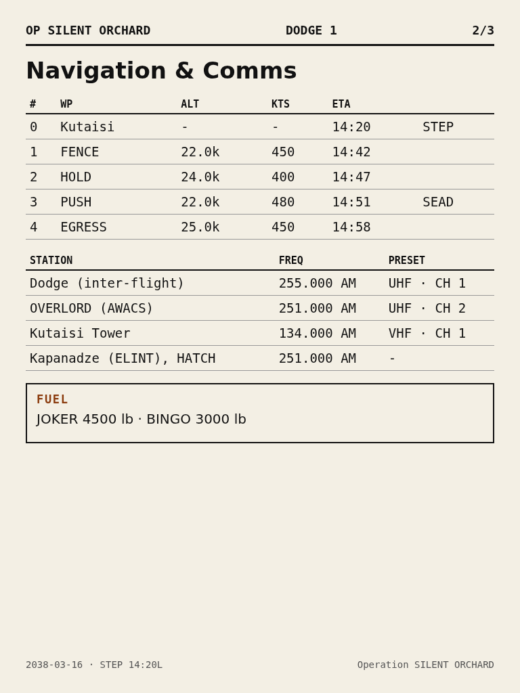</a> <a href="silent_orchard/kneeboard/03_threats.png">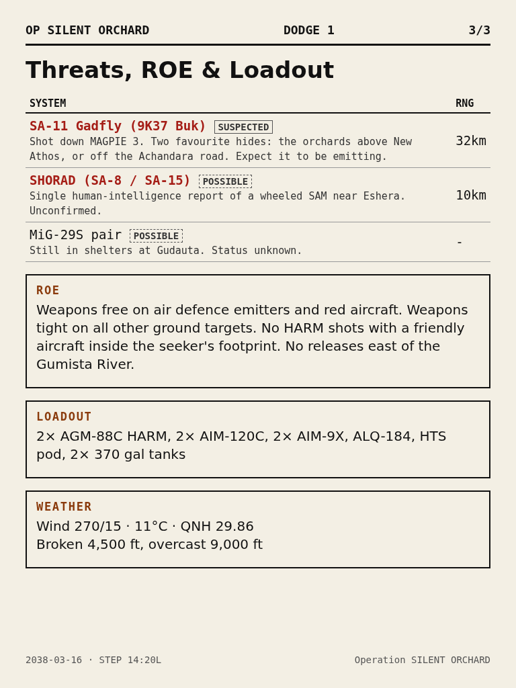</a> 

## Operation HOLD FAST: Defend the Gumista Line

**Caucasus** · **2× A-10C II** · **CAS** · 2038-03-18, step 05:50L · Hot start

> "I can hear tracks. I can't see them yet. Get here." CHISEL, 0531

The brigade the Bzyb strike was meant to stall is moving. At 0520 Captain Brenner's company on the Gumista reported engine noise west of the river. Two bridges cross the Gumista into Sukhumi, the coast road and the highway, and Brenner has one company to hold both.

**Primary objective:** Destroy the attacking column before it crosses the Gumista.

| Download | |
| --- | --- |
| Mission | [gumista_line.miz](gumista_line/gumista_line.miz) |
| Briefing | [briefing.html](gumista_line/briefing.html) |
| Slide deck | [slides.html](gumista_line/slides.html) |
| Director's cut | [director.html](gumista_line/director.html): **spoilers**, for whoever runs or debriefs the mission |

| Kneeboard | [01_mission.png](gumista_line/kneeboard/01_mission.png) · [02_nav.png](gumista_line/kneeboard/02_nav.png) · [03_threats.png](gumista_line/kneeboard/03_threats.png) |

   

## Operation BLUE WATER: Hold the Line at Sea

**Caucasus** · **2× F-14B Tomcat** · **Fleet defense** · 2038-03-20, step 16:40L · Carrier, Air refuelling

> "They only have to get lucky once. You have to be lucky every time. Tonight, be lucky early." BISHOP, 1600 brief

With the Gumista holding, the coalition moved the Stennis strike group into the eastern Black Sea to put fighters over Sukhumi around the clock. The answer from the north was always going to come by air. Overnight, two Tu-22M3 Backfires moved forward. Each carries a Kh-22 that can hit a carrier from 300 km away.

**Primary objective:** Destroy the bomber raid before it reaches the Kh-22 launch line.

| Download | |
| --- | --- |
| Mission | [blue_water.miz](blue_water/blue_water.miz) |
| Briefing | [briefing.html](blue_water/briefing.html) |
| Slide deck | [slides.html](blue_water/slides.html) |
| Director's cut | [director.html](blue_water/director.html): **spoilers**, for whoever runs or debriefs the mission |

| Kneeboard | [01_mission.png](blue_water/kneeboard/01_mission.png) · [02_nav.png](blue_water/kneeboard/02_nav.png) · [03_threats.png](blue_water/kneeboard/03_threats.png) |

   

## Operation DEEP CUT: Through the Back Door

**Caucasus** · **2× AV-8B Harrier** · **Strike** · 2038-03-22, step 10:30L · Air refuelling, Low level, Different recovery field

> "Nobody flies down that valley. That's the point." HATCH, 0900 brief

The two MiG-29s at Gudauta have shown up on every mission this month. They don't fly much because they don't have much fuel. Every night a few tanker trucks come down the coast road from Gagra to keep them topped up.

**Primary objective:** Destroy the fuel tanker trucks supplying Gudauta.

| Download | |
| --- | --- |
| Mission | [deep_cut.miz](deep_cut/deep_cut.miz) |
| Briefing | [briefing.html](deep_cut/briefing.html) |
| Slide deck | [slides.html](deep_cut/slides.html) |
| Director's cut | [director.html](deep_cut/director.html): **spoilers**, for whoever runs or debriefs the mission |

| Kneeboard | [01_mission.png](deep_cut/kneeboard/01_mission.png) · [02_nav.png](deep_cut/kneeboard/02_nav.png) · [03_threats.png](deep_cut/kneeboard/03_threats.png) |

   

## Operation LIFELINE: RESCAP for Uzi 2-2

**Caucasus** · **2× F/A-18C Hornet** · **RESCAP** · 2038-03-24, step 09:10L · Different recovery field, Hot start

> "She's got a radio, a pistol and about twenty minutes. You've got two Hornets. Make the twenty minutes last." RAWHIDE, on the scramble line

At 0735, Uzi 2-2, an F-16 on a road recce north of the Gumista, took a missile nobody saw launch. Capt. Mara "SOCKS" Lindqvist ejected over the hills above Eshera, four miles behind the line. Her beacon is good and she's checked in twice on guard. The second time she said she could hear engines.

**Primary objective:** Stop the search party before it reaches Uzi 2-2.

| Download | |
| --- | --- |
| Mission | [lifeline.miz](lifeline/lifeline.miz) |
| Briefing | [briefing.html](lifeline/briefing.html) |
| Slide deck | [slides.html](lifeline/slides.html) |
| Director's cut | [director.html](lifeline/director.html): **spoilers**, for whoever runs or debriefs the mission |

| Kneeboard | [01_mission.png](lifeline/kneeboard/01_mission.png) · [02_nav.png](lifeline/kneeboard/02_nav.png) · [03_threats.png](lifeline/kneeboard/03_threats.png) |

   

## Operation GREY HULL: Harpoon Strike off Gelendzhik

**Caucasus** · **2× F/A-18C Hornet** · **Anti-ship** · 2038-03-26, step 06:50L · Carrier, Air refuelling, Low level

> "Two contacts, two ships each, and one of them is full of grain. I'd love to tell you which. Darkstar's going to tell you instead, and you're going to check." PRISM, 0600 brief

After the Backfire raid, the Black Sea Fleet stopped sending bombers and started sending ships. Last night a surface action group left Novorossiysk under cover of the weather: a Krivak-class frigate and a Grisha corvette, heading southeast to put SA-N-4s and a towed sonar between the Stennis and the coast.

**Primary objective:** Disable the surface action group (at least half the group's damage).

| Download | |
| --- | --- |
| Mission | [grey_hull.miz](grey_hull/grey_hull.miz) |
| Briefing | [briefing.html](grey_hull/briefing.html) |
| Slide deck | [slides.html](grey_hull/slides.html) |
| Director's cut | [director.html](grey_hull/director.html): **spoilers**, for whoever runs or debriefs the mission |

| Kneeboard | [01_mission.png](grey_hull/kneeboard/01_mission.png) · [02_nav.png](grey_hull/kneeboard/02_nav.png) · [03_threats.png](grey_hull/kneeboard/03_threats.png) |

   

# Standalone training

Syllabus events. Everything is briefed as it is: training rules, grade sheet, range players.

## Training · Det work-ups, event AR/LL-1: Air Refuelling and Low-Level Navigation

**Caucasus** · **2× F/A-18C Hornet** · **AAR & low level** · 2038-02-09, step 09:00L · Air refuelling, Low level

> "Plugging the basket is a skill. Hitting a checkpoint to the second is a habit. Today I'm grading habits." WREN, mass brief

A month before the deployment turns hot, the Hornet detachment is in Georgia for the partner exercise, flying from Kutaisi. The detachment's training officer wants every pilot current on the two skills that get people killed when they're rusty: plugging a tanker basket, and flying low and fast through terrain that doesn't forgive mistakes.

**Primary objective:** Fly the low-level route with at least 3 of 4 checkpoints and the TOT on time (±30 s), with no altitude knock-it-off.

| Download | |
| --- | --- |
| Mission | [train_tanker_lowlevel.miz](train_tanker_lowlevel/train_tanker_lowlevel.miz) |
| Briefing | [briefing.html](train_tanker_lowlevel/briefing.html) |
| Slide deck | [slides.html](train_tanker_lowlevel/slides.html) |
| Instructor view | [director.html](train_tanker_lowlevel/director.html): every trigger and how each grade is decided |

| Kneeboard | [01_mission.png](train_tanker_lowlevel/kneeboard/01_mission.png) · [02_nav.png](train_tanker_lowlevel/kneeboard/02_nav.png) · [03_rules.png](train_tanker_lowlevel/kneeboard/03_rules.png) |

   

## Training · Det work-ups, event SW-2: Air-to-Ground Weapons Qualification

**Caucasus** · **1× F/A-18C Hornet** · **Air-to-ground range** · 2038-02-11, step 10:30L

> "Three events, three targets, one pattern. I don't care how fast you go. I care that every bomb lands where you said it would." WREN, range brief

Two days after LONG VALLEY, the detachment moves its weapons work east. The Georgian Land Forces have lent the exercise a tactical range on the steppe near Udabno: open, flat and empty, with hulks and old trucks laid out as targets. It's the best range the detachment has flown on in a year.

**Primary objective:** Destroy T-1, T-2 and T-3 in order, each with its briefed weapon, with no range fouls.

| Download | |
| --- | --- |
| Mission | [train_range_day.miz](train_range_day/train_range_day.miz) |
| Briefing | [briefing.html](train_range_day/briefing.html) |
| Slide deck | [slides.html](train_range_day/slides.html) |
| Instructor view | [director.html](train_range_day/director.html): every trigger and how each grade is decided |

| Kneeboard | [01_mission.png](train_range_day/kneeboard/01_mission.png) · [02_nav.png](train_range_day/kneeboard/02_nav.png) · [03_rules.png](train_range_day/kneeboard/03_rules.png) |

   

## Training · Det work-ups, event A/A-3: Intercepts and BFM against Aggressors

**Caucasus** · **1× F/A-18C Hornet** · **Air-to-air (BFM)** · 2038-02-13, step 14:00L

> "They will beat you today. The question is how many times, and whether you'll know why when we watch the tapes." WREN, mass brief

The last work-up event is the one everyone wants. A partner air force has sent an aggressor detachment to Batumi for the exercise: one MiG-29 and a section of F-5Es flown by pilots who do nothing but fight Western fighters. For the Hornet detachment, it's the closest thing to the real thing short of a war.

**Primary objective:** Kill Bandit 11 (BVR) and Bandit 21 (BFM) with no hard-deck knock-it-off.

| Download | |
| --- | --- |
| Mission | [train_red_air.miz](train_red_air/train_red_air.miz) |
| Briefing | [briefing.html](train_red_air/briefing.html) |
| Slide deck | [slides.html](train_red_air/slides.html) |
| Instructor view | [director.html](train_red_air/director.html): every trigger and how each grade is decided |

| Kneeboard | [01_mission.png](train_red_air/kneeboard/01_mission.png) · [02_nav.png](train_red_air/kneeboard/02_nav.png) · [03_rules.png](train_red_air/kneeboard/03_rules.png) |

   

